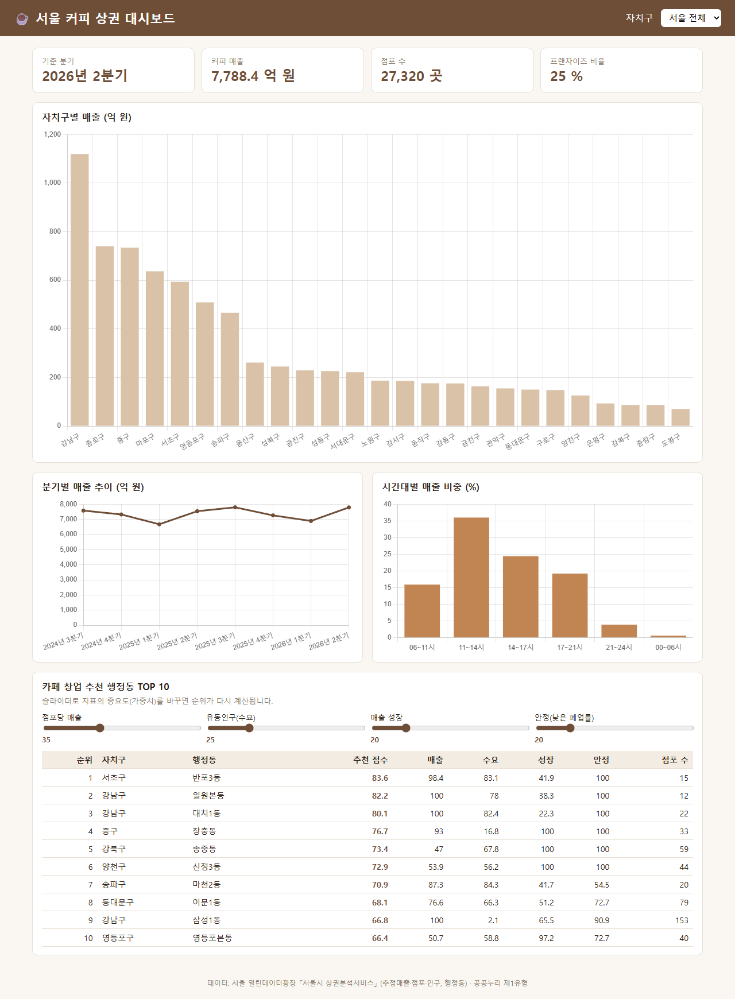

# 서울 커피 상권 분석 프로젝트

서울시 상권분석서비스 데이터로 "서울에서 커피 장사가 잘되는 곳은 어디인가?" 를 분석하고,
결과를 **FastAPI + HTML/CSS/JS 대시보드**로 만드는 프로젝트 교안과 예제 코드입니다.

- **배포된 대시보드: https://seoul-cafe-analysis.onrender.com** (무료 서버라 한동안 접속이 없으면 첫 화면이 뜨는 데 수십 초 걸립니다) · API 문서 [/docs](https://seoul-cafe-analysis.onrender.com/docs)
- 교안: [서울커피상권분석_프로젝트교안.pdf](서울커피상권분석_프로젝트교안.pdf) (36쪽) · 원고 `guide/*.md`
- 분석: NumPy · pandas · seaborn (`analysis/`)
- 서비스: FastAPI (`service/main.py`) + HTML/CSS/JS + Chart.js (`service/static/`)



## 빠르게 실행하기

```powershell
python -m venv .venv
.venv\Scripts\Activate.ps1
pip install -r requirements.txt

python analysis/02_데이터정리.py      # data/raw → data/clean
python analysis/03_탐색분석.py        # 그래프 → images/
python analysis/04_창업점수.py        # 창업 추천 점수
uvicorn service.main:app --reload     # http://127.0.0.1:8000 , API 문서 /docs
```

`data/raw` 에 2024년 3분기 ~ 2026년 2분기 데이터가 들어 있어 인증키 없이 바로 실행됩니다.
최신 데이터를 직접 받으려면 서울 열린데이터광장 인증키를 `.env` 에 `SEOUL_API_KEY=내키` 로 적고
`python analysis/01_데이터받기.py` 를 실행하세요. (`.env` 는 저장소에 올리지 않습니다)

## 교안 구성

| 장 | 내용 |
|---|---|
| 0 | 프로젝트 안내 - 데이터, 준비, 일정 |
| 1 | 데이터 받기 - Open API, requests, 1,000줄씩 나눠 받기 |
| 2 | 데이터 정리 - pandas 열 이름, 병합, 0 나누기·빈 값 |
| 3 | 탐색 분석 - 질문 6개, seaborn 그래프, 관계와 원인 |
| 4 | 창업 추천 점수 - NumPy 정규화(clip), 가중치 |
| 5 | 분석 API - FastAPI, 쿼리 매개변수, 404/400 |
| 6 | 대시보드 - fetch, Chart.js, 이벤트 |
| 7 | 마무리 - 확장 아이디어, 발표, 점검표, 평가 기준 |

교안 PDF 다시 만들기: `python tools/build_guide.py` (그림: `python tools/make_figures.py`)

## 배포 (Render)

`render.yaml` 에 설정이 들어 있습니다. Render 대시보드 → **New → Blueprint** → 이 저장소 → **Deploy Blueprint**.
이후 `main` 에 push 하면 자동으로 다시 배포됩니다.

## 데이터 출처

서울 열린데이터광장 「서울시 상권분석서비스」 추정매출 · 점포 · 길단위인구 · 상주인구 · 직장인구 (행정동),
공공누리 제1유형 (출처 표시). 매출은 카드 결제 등으로 계산한 **추정값**입니다.

강사 김대철
