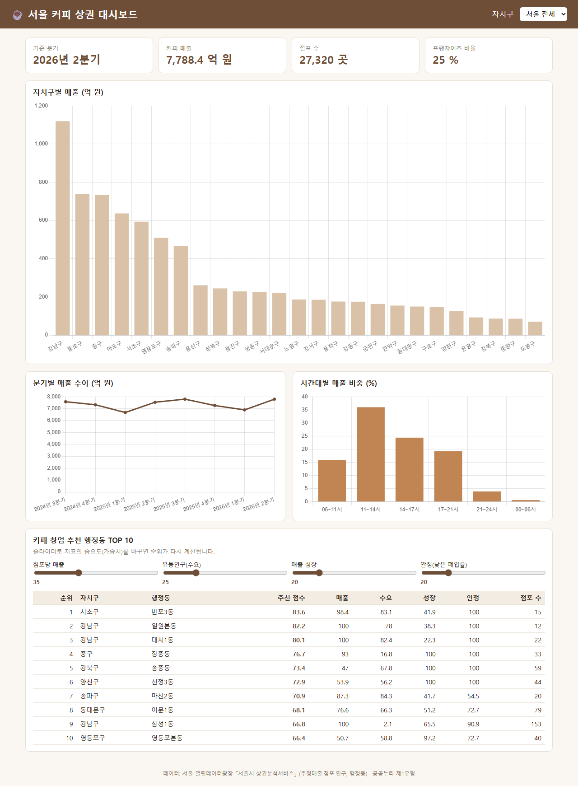
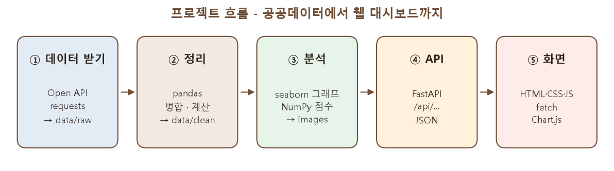

# 0장. 프로젝트 안내 - 서울 커피 상권 분석

## 이 프로젝트에서 만드는 것

서울시가 공개한 **상권분석 데이터**로 "서울에서 커피 장사가 잘되는 곳은 어디인가?" 를 분석하고, 그 결과를 누구나 브라우저로 볼 수 있는 **웹 대시보드**로 만든다.



분석은 **NumPy · pandas · seaborn**, 서비스는 **FastAPI(서버) + HTML/CSS/JS(화면)** 로 만든다. 지금까지 배운 것을 한 프로젝트에 모두 쓴다.



| 단계 | 장 | 쓰는 도구 | 결과물 |
|---|---|---|---|
| ① 데이터 받기 | 1장 | requests, pandas | `data/raw/*.csv` |
| ② 정리 | 2장 | pandas | `data/clean/*.csv` |
| ③ 분석 | 3·4장 | seaborn, NumPy | `images/*.png`, 창업 점수 |
| ④ API | 5장 | FastAPI | `/api/...` 주소들 |
| ⑤ 화면 | 6장 | HTML · CSS · JS, Chart.js | 대시보드 |
| 마무리 | 7장 | - | 발표, 확장 아이디어, 점검표 |
| ⑥ 배포 | 8장 | Render | 누구나 여는 공개 주소 |
| ⑦ 지도 (확장) | 9장 | pyproj, GeoJSON, Leaflet | 추천 점수 색칠 지도 + 커피숍 위치 |

## 0-1. 데이터 소개

**서울시 상권분석서비스**(서울 열린데이터광장)는 카드 결제 자료 등으로 행정동마다 업종별 매출을 **추정**해 분기마다 공개한다. 이 프로젝트는 그중 **커피-음료** 업종(코드 `CS100010`)을 쓴다.

| 데이터 | 한 줄 | 쓰는 곳 |
|---|---|---|
| 추정매출 (행정동) | 분기 × 행정동 × 업종 | 매출, 요일·시간대·연령·성별 매출 |
| 점포 (행정동) | 분기 × 행정동 × 업종 | 점포 수, 프랜차이즈 수, 개업률·폐업률 |
| 길단위인구 (행정동) | 분기 × 행정동 | 유동인구 |
| 상주인구 · 직장인구 (행정동) | 분기 × 행정동 | 사는 사람, 일하는 사람 |

> **추정 매출이다.** 실제 가게 장부가 아니라 카드 결제 등으로 계산한 추정값이다. 보고서와 발표에 꼭 밝혀 두자. 데이터는 공공누리 제1유형으로, 출처(서울 열린데이터광장)를 밝히면 자유롭게 쓸 수 있다.

## 0-2. 준비

1. 프로젝트 폴더 `seoul-cafe-analysis` 를 받는다. (강사에게 받거나 저장소에서 내려받기)
2. VS Code 로 폴더를 열고, 터미널에서 가상 환경을 만든 뒤 라이브러리를 설치한다.

```powershell
python -m venv .venv
.venv\Scripts\Activate.ps1
pip install -r requirements.txt
```

3. 폴더 구성

```text
seoul-cafe-analysis
├─ analysis/            분석 스크립트 (01 ~ 04, scoring.py, 지도용 05 · 06)
├─ data/raw/            받은 원본 (영문 열 이름)
├─ data/clean/          정리한 표 (한글 열 이름)
├─ images/              분석 그래프
├─ service/main.py      FastAPI 서버
├─ service/static/      화면 (index.html, style.css, app.js, 지도 map.js)
├─ render.yaml          배포 설정 (8장)
└─ .env                 내 인증키 (저장소에 올리지 않는다)
```

> **인증키가 없어도 시작할 수 있다.** `data/raw` 에 2024년 3분기 ~ 2026년 2분기 데이터가 들어 있다. 1장의 받기는 건너뛰고 2장부터 해도 된다.

## 0-3. 일정 예시 (2주)

| 기간 | 할 일 | 점검 |
|---|---|---|
| 1~2일 | 1·2장 - 데이터 받기, 정리 | `data/clean` 두 파일이 생겼나 |
| 3~5일 | 3·4장 - 질문 정하기, 그래프, 점수 | 질문마다 그래프 1개 + 한 줄 해석 |
| 6~8일 | 5·6장 - API, 화면 | 브라우저에서 대시보드가 뜨나 |
| 9~10일 | 나만의 분석 1~2개 추가 (7장 아이디어) | 다른 학생과 다른 점이 있나 |
| 마지막 | 8장 배포, 발표 자료, 점검표 확인 | 휴대폰으로 배포 주소가 열리나 |

## 0-4. 공부하는 방법

- 장마다 **코드 전체**가 들어 있다. 먼저 그대로 실행해 결과를 보고, 그다음 한 줄씩 읽으며 주석을 확인하자.
- 코드 맨 위의 **── 전체 흐름 ──** 을 먼저 읽으면 긴 코드도 길을 잃지 않는다.
- 장 끝의 **직접 해 보기** 는 내 프로젝트를 다른 사람과 다르게 만드는 재료다. 적어도 두 개는 해 보자.
