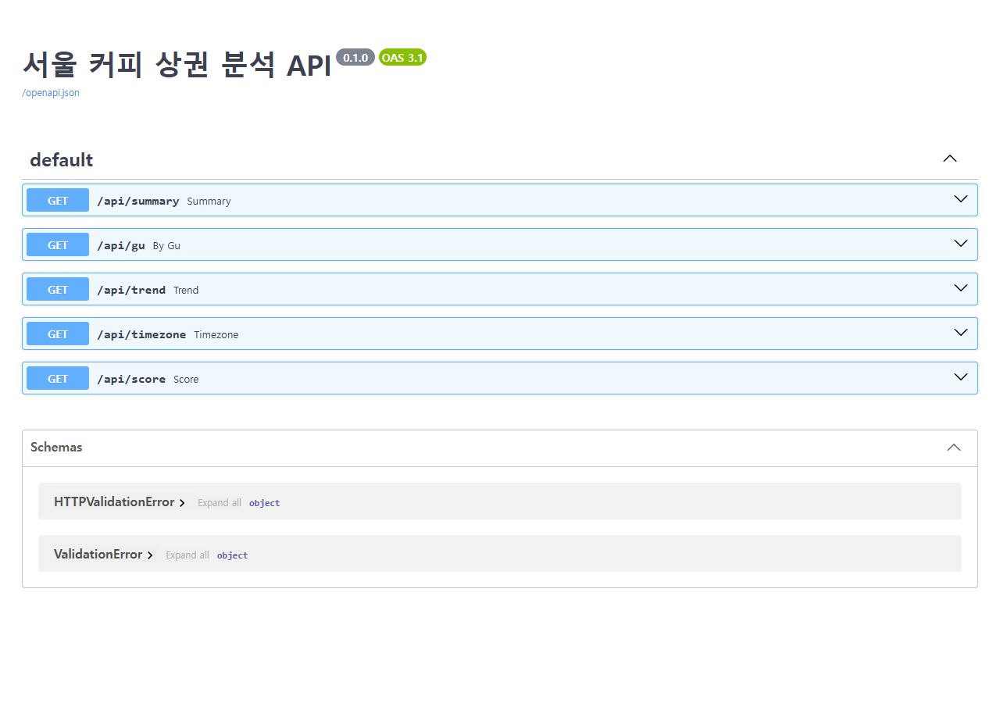

# 5장. 분석 API - FastAPI

## 학습 목표

- 분석 결과를 **JSON** 으로 돌려주는 API 주소를 설계한다.
- FastAPI 에서 쿼리 매개변수(`?gu=강남구`)를 받고, 잘못된 요청에 오류(404, 400)를 돌려준다.
- `/docs` 화면으로 API 를 직접 시험한다.

## 5-1. 왜 API 로 나눌까

분석 결과를 그림 파일로만 두면 보는 사람이 자치구나 가중치를 바꿔 볼 수 없다. **서버(FastAPI)** 가 데이터를 계산해 JSON 으로 주고, **화면(JS)** 이 그것을 받아 그리면, 화면에서 고른 조건에 따라 그때그때 새 결과를 보여 줄 수 있다.

```text
브라우저 (app.js)  ──  GET /api/trend?gu=마포구  ──▶  FastAPI (main.py)
                   ◀──  [{"분기": "2024년 3분기", "매출_억원": 677.2}, ...]  ──  pandas 로 계산
```

## 5-2. API 설계

| 주소 | 하는 일 | 매개변수 |
|---|---|---|
| `GET /api/summary` | 카드 4개 (분기, 매출, 점포 수, 프랜차이즈 비율) | `gu` (선택) |
| `GET /api/gu` | 자치구별 매출·점포 수·점포당 매출 | - |
| `GET /api/trend` | 분기별 매출 추이 | `gu` (선택) |
| `GET /api/timezone` | 시간대별 매출 비중 | `gu` (선택) |
| `GET /api/score` | 창업 추천 점수 상위 10 | `w_sales`, `w_demand`, `w_growth`, `w_stable`, `gu`, `top` |

`gu` 를 비우면 서울 전체, `gu=마포구` 처럼 주면 그 자치구만 계산한다.

## 5-3. 서버 코드

<!-- file: service/main.py -->

```python
"""
main.py - 서울 커피 상권 분석 결과를 JSON 으로 돌려주는 FastAPI 서버 + 화면(static) 제공

── 전체 흐름 ──
① 서버가 켜질 때 data/clean 의 정리된 CSV 두 개를 한 번 읽어 둔다 (요청마다 읽지 않는다)
② /api/... 주소마다 pandas 로 필요한 표를 만들어 JSON(딕셔너리 목록)으로 돌려준다
③ /api/score 는 화면에서 보낸 가중치로 창업 추천 점수를 그때그때 다시 계산한다 (analysis/scoring.py)
④ 주소 / 로 들어오면 static/index.html 화면을 보여 준다
⑤ (9장 지도) /api/stores 는 커피숍 위치 점, /api/dong-geo 는 행정동 경계선, /api/map 은 동마다 색칠할 점수

실행 (프로젝트 폴더에서):  uvicorn service.main:app --reload
브라우저:  http://127.0.0.1:8000   ·  API 문서: http://127.0.0.1:8000/docs
"""
import sys
from pathlib import Path

import pandas as pd
from fastapi import FastAPI, HTTPException
from fastapi.middleware.gzip import GZipMiddleware
from fastapi.responses import FileResponse
from fastapi.staticfiles import StaticFiles

ROOT = Path(__file__).resolve().parent.parent
sys.path.insert(0, str(ROOT / "analysis"))               # analysis/scoring.py 를 가져오기 위해
from scoring import add_growth, startup_score            # noqa: E402  (경로를 넣은 뒤 가져온다)

CLEAN = ROOT / "data" / "clean"
EOK = 100_000_000                                        # 1억

# ① 시작할 때 한 번 읽기. 코드 열은 글자로 읽어야 앞자리 0 이 사라지지 않는다
Q = pd.read_csv(CLEAN / "커피_분기별.csv", dtype={"분기": str, "행정동코드": str})
LAST = pd.read_csv(CLEAN / "커피_최근분기.csv", dtype={"분기": str, "행정동코드": str})
LATEST = LAST["분기"].iloc[0]
SCORE_BASE = add_growth(LAST, Q)                         # 점수 계산에 쓸 표 (성장률까지 붙인 것)
SCORE_BASE = SCORE_BASE[SCORE_BASE["점포수"] >= 10]      # 점포 10곳 미만 동은 제외 (04 와 같은 기준)

# ⑤ 지도용 데이터 (05·06 스크립트가 만든 파일)
STORES = pd.read_csv(CLEAN / "커피숍_위치.csv", dtype={"개업일": str})
DONG_GEO = CLEAN / "서울_행정동.geojson"

app = FastAPI(title="서울 커피 상권 분석 API")
# 응답이 1KB 보다 크면 압축(gzip)해서 보낸다. 커피숍 1만 4천 곳 목록(약 2.7MB)이 약 1/5(0.6MB) 로 줄어든다
app.add_middleware(GZipMiddleware, minimum_size=1000)


def quarter_label(code):
    """20262 → '2026년 2분기'"""
    return f"{code[:4]}년 {code[4]}분기"


def pick_gu(df, gu):
    """gu 가 주어지면 그 자치구만, 없으면 전체. 없는 자치구면 404 오류"""
    if not gu:
        return df
    if gu not in set(df["자치구"]):
        raise HTTPException(status_code=404, detail=f"자치구 '{gu}' 가 없습니다")
    return df[df["자치구"] == gu]


@app.get("/api/summary")
def summary(gu: str = ""):
    """맨 위 카드 4개: 분기, 매출(억 원), 점포 수, 프랜차이즈 비율"""
    d = pick_gu(LAST, gu)
    return {
        "분기": quarter_label(LATEST),
        "매출_억원": round(d["매출액"].sum() / EOK, 1),
        "점포수": int(d["점포수"].sum()),
        "프랜차이즈비율": round(d["프랜차이즈수"].sum() / d["점포수"].sum() * 100, 1),
    }


@app.get("/api/gu")
def by_gu():
    """자치구별 매출(억 원)·점포 수·점포당 매출(백만 원), 매출 큰 순"""
    g = LAST.groupby("자치구")[["매출액", "점포수"]].sum()
    g["점포당매출"] = g["매출액"] / g["점포수"]
    g = g.sort_values("매출액", ascending=False)
    rows = []
    for name, r in g.iterrows():                         # 표의 한 줄을 딕셔너리 하나로
        rows.append({"자치구": name, "매출_억원": round(r["매출액"] / EOK, 1),
                     "점포수": int(r["점포수"]), "점포당매출_백만원": round(r["점포당매출"] / 1e6, 1)})
    return rows


@app.get("/api/trend")
def trend(gu: str = ""):
    """분기별 매출(억 원) 추이"""
    d = pick_gu(Q, gu)
    t = d.groupby("분기")["매출액"].sum()
    return [{"분기": quarter_label(k), "매출_억원": round(v / EOK, 1)} for k, v in t.items()]


@app.get("/api/timezone")
def timezone(gu: str = ""):
    """시간대별 매출 비중(%)"""
    times = ["06~11시", "11~14시", "14~17시", "17~21시", "21~24시", "00~06시"]
    s = pick_gu(LAST, gu)[times].sum()
    return [{"시간대": t, "비중": round(s[t] / s.sum() * 100, 1)} for t in times]


@app.get("/api/score")
def score(w_sales: float = 35, w_demand: float = 25, w_growth: float = 20, w_stable: float = 20,
          gu: str = "", top: int = 10):
    """창업 추천 점수 상위 top 곳. 가중치 4개는 화면의 슬라이더 값(0~100)"""
    weights = {"매출": w_sales, "수요": w_demand, "성장": w_growth, "안정": w_stable}
    if sum(weights.values()) <= 0:
        raise HTTPException(status_code=400, detail="가중치를 하나 이상 0 보다 크게 주세요")
    # 점수는 서울 전체 기준으로 매긴 뒤, 자치구를 고르면 그 안에서 순위를 본다
    ranked = startup_score(SCORE_BASE, weights)
    ranked = pick_gu(ranked, gu).head(top)
    cols = ["자치구", "행정동", "추천점수", "매출점수", "수요점수", "성장점수", "안정점수", "점포수"]
    return ranked[cols].round(1).to_dict(orient="records")


# ⑤ 지도 ─────────────────────────────────────────────
@app.get("/api/stores")
def stores(gu: str = ""):
    """영업 중인 커피숍 위치. gu 를 주면 그 자치구만 (서울 전체는 약 1만 4천 곳)"""
    d = pick_gu(STORES, gu)
    return d[["상호", "주소", "개업일", "위도", "경도"]].to_dict(orient="records")


@app.get("/api/dong-geo")
def dong_geo():
    """서울 행정동 경계선(GeoJSON). 파일을 그대로 보낸다"""
    return FileResponse(DONG_GEO, media_type="application/geo+json")


@app.get("/api/map")
def map_scores(w_sales: float = 35, w_demand: float = 25, w_growth: float = 20, w_stable: float = 20):
    """행정동마다 지도 색에 쓸 값. {행정동코드: {추천점수, 점포수, ...}} 모양으로 돌려준다
    슬라이더 가중치가 같으면 /api/score 의 표와 같은 점수다 (점포 10곳 미만 동은 빠진다)"""
    weights = {"매출": w_sales, "수요": w_demand, "성장": w_growth, "안정": w_stable}
    if sum(weights.values()) <= 0:
        raise HTTPException(status_code=400, detail="가중치를 하나 이상 0 보다 크게 주세요")
    ranked = startup_score(SCORE_BASE, weights)
    ranked["순위"] = range(1, len(ranked) + 1)                 # 점수 높은 순으로 1, 2, 3, ...
    ranked["매출_억원"] = ranked["매출액"] / EOK
    cols = ["행정동코드", "순위", "추천점수", "점포수", "매출_억원"]
    return ranked[cols].round(1).set_index("행정동코드").to_dict(orient="index")


# ④ 화면 파일 (index.html, style.css, app.js). API 주소보다 뒤에 붙여야 /api/... 가 가려지지 않는다
app.mount("/", StaticFiles(directory=Path(__file__).parent / "static", html=True), name="static")
```

## 5-4. 실행과 시험

프로젝트 폴더(`seoul-cafe-analysis`)에서 실행한다. `service.main:app` 은 "service 폴더의 main.py 안의 app" 이라는 뜻이다.

```powershell
uvicorn service.main:app --reload
```

브라우저에서 `http://127.0.0.1:8000/docs` 를 열면 FastAPI 가 자동으로 만든 **API 문서**가 나온다. 주소를 하나 펼쳐 **Try it out → Execute** 를 누르면 바로 시험할 수 있다.



| 시험 | 결과 |
|---|---|
| `/api/summary` | `{"분기": "2026년 2분기", "매출_억원": 7788.4, "점포수": 27320, "프랜차이즈비율": 25.0}` |
| `/api/trend?gu=마포구` | 마포구의 8분기 매출 |
| `/api/trend?gu=없는구` | **404** `{"detail": "자치구 '없는구' 가 없습니다"}` |
| `/api/score?w_sales=0&w_demand=0&w_growth=0&w_stable=0` | **400** 가중치 오류 |

## 5-5. 코드에서 꼭 볼 곳

- **CSV 는 서버가 켜질 때 한 번만 읽는다.** 요청마다 읽으면 느리다. 데이터가 바뀌면 서버를 다시 켜면 된다 (`--reload` 는 코드가 바뀔 때 자동으로 다시 켠다).
- **`sys.path.insert`** - `analysis/scoring.py` 를 가져오기 위해 그 폴더를 파이썬이 찾는 경로에 더했다. 분석과 서비스가 **같은 계산 함수**를 쓰므로, 4장의 결과와 화면의 결과가 항상 같다.
- **`HTTPException`** - 잘못된 요청은 500(서버 오류)이 아니라 404·400 같은 알맞은 코드로 돌려준다. 화면(JS)은 이 코드를 보고 안내 문구를 띄운다.
- **`app.mount("/", StaticFiles(...))`** 는 맨 마지막에 둔다. 먼저 두면 `/api/...` 주소까지 정적 파일로 찾으려 해서 API 가 가려진다.

## 직접 해 보기

1. 요일별 매출 비중을 돌려주는 `/api/weekday` 를 만들어 보자. (`/api/timezone` 을 복사해 열 목록만 바꾼다)
2. 행정동 하나의 상세 정보를 돌려주는 `/api/dong/{행정동코드}` 를 만들어 보자. 없는 코드면 404.
