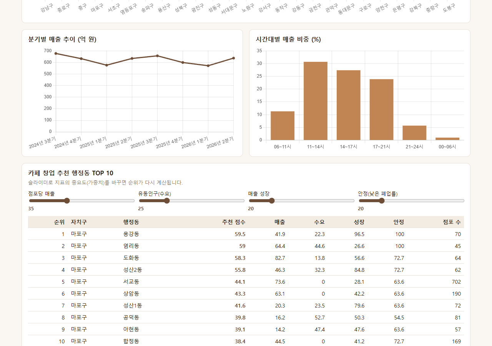

# 6장. 대시보드 화면 - HTML · CSS · JS

## 학습 목표

- HTML 로 화면 뼈대를, CSS grid 로 카드·차트 배치를 만든다.
- JS `fetch` 로 API 를 부르고, **Chart.js** 로 차트를 그린다.
- 선택 상자와 슬라이더의 **이벤트**로 화면을 다시 그린다.

## 6-1. 화면 구성

| 영역 | HTML | 채우는 JS 함수 | 부르는 API |
|---|---|---|---|
| 자치구 선택 | `<select id="gu-select">` | `init()` | `/api/gu` |
| 카드 4개 | `<b id="c-sales">` … | `loadSummary()` | `/api/summary` |
| 자치구별 매출 | `<canvas id="chart-gu">` | `loadGu()` | `/api/gu` |
| 분기 추이 | `<canvas id="chart-trend">` | `loadTrend()` | `/api/trend` |
| 시간대 비중 | `<canvas id="chart-time">` | `loadTime()` | `/api/timezone` |
| 추천 TOP 10 | 슬라이더 4개 + `<tbody id="score-body">` | `loadScore()` | `/api/score` |

## 6-2. HTML - 뼈대

<!-- file: service/static/index.html -->

```html
<!doctype html>
<!--
  index.html - 서울 커피 상권 대시보드 화면 (뼈대)
  ── 전체 흐름 ──
  ① 위쪽: 제목 + 자치구 선택 상자
  ② 카드 4개: 분기, 매출, 점포 수, 프랜차이즈 비율  (app.js 가 /api/summary 로 채운다)
  ③ 차트 3개: 자치구별 매출, 분기별 추이, 시간대 비중  (Chart.js 로 그린다)
  ④ 창업 추천: 가중치 슬라이더 4개 + 상위 10 표  (슬라이더를 움직이면 /api/score 를 다시 부른다)
  ⑤ 지도: 행정동을 추천 점수로 색칠 + 커피숍 위치 점  (Leaflet 으로 그린다, 9장)
-->
<html lang="ko">
<head>
  <meta charset="utf-8">
  <meta name="viewport" content="width=device-width, initial-scale=1">
  <title>서울 커피 상권 대시보드</title>
  <link rel="stylesheet" href="style.css?v=9">   <!-- ?v=9 : 파일을 고치면 숫자를 올린다 → 브라우저가 옛 파일(캐시) 대신 새로 받는다 -->
  <!-- 차트 라이브러리 Chart.js (인터넷에서 불러온다) -->
  <script src="https://cdn.jsdelivr.net/npm/chart.js@4.4.1/dist/chart.umd.min.js"></script>
  <!-- 지도 라이브러리 Leaflet: 모양(css)과 기능(js) 두 파일을 함께 불러온다 -->
  <link rel="stylesheet" href="https://cdn.jsdelivr.net/npm/leaflet@1.9.4/dist/leaflet.css">
  <script src="https://cdn.jsdelivr.net/npm/leaflet@1.9.4/dist/leaflet.js"></script>
</head>
<body>
  <!-- ① 제목과 자치구 선택 -->
  <header>
    <h1>☕ 서울 커피 상권 대시보드</h1>
    <label>자치구
      <select id="gu-select">
        <option value="">서울 전체</option>   <!-- 나머지 자치구는 app.js 가 채운다 -->
      </select>
    </label>
  </header>

  <main>
    <!-- ② 요약 카드 -->
    <section class="cards">
      <div class="card"><span>기준 분기</span><b id="c-quarter">-</b></div>
      <div class="card"><span>커피 매출</span><b id="c-sales">-</b></div>
      <div class="card"><span>점포 수</span><b id="c-stores">-</b></div>
      <div class="card"><span>프랜차이즈 비율</span><b id="c-frc">-</b></div>
    </section>

    <!-- ③ 차트 3개 -->
    <section class="charts">
      <div class="panel wide"><h2>자치구별 매출 (억 원)</h2><canvas id="chart-gu"></canvas></div>
      <div class="panel"><h2>분기별 매출 추이 (억 원)</h2><canvas id="chart-trend"></canvas></div>
      <div class="panel"><h2>시간대별 매출 비중 (%)</h2><canvas id="chart-time"></canvas></div>
    </section>

    <!-- ④ 창업 추천 점수 -->
    <section class="panel">
      <h2>카페 창업 추천 행정동 TOP 10</h2>
      <p class="hint">슬라이더로 지표의 중요도(가중치)를 바꾸면 순위가 다시 계산됩니다.</p>
      <div class="sliders">
        <label>점포당 매출 <input type="range" id="w-sales" min="0" max="100" value="35"><output>35</output></label>
        <label>유동인구(수요) <input type="range" id="w-demand" min="0" max="100" value="25"><output>25</output></label>
        <label>매출 성장 <input type="range" id="w-growth" min="0" max="100" value="20"><output>20</output></label>
        <label>안정(낮은 폐업률) <input type="range" id="w-stable" min="0" max="100" value="20"><output>20</output></label>
      </div>
      <table>
        <thead><tr><th>순위</th><th>자치구</th><th>행정동</th><th>추천 점수</th>
          <th>매출</th><th>수요</th><th>성장</th><th>안정</th><th>점포 수</th></tr></thead>
        <tbody id="score-body"></tbody>
      </table>
    </section>

    <!-- ⑤ 지도 (9장) -->
    <section class="panel">
      <h2>지도로 보기</h2>
      <p class="hint">색이 진할수록 추천 점수가 높은 행정동입니다 (위 슬라이더를 따라 바뀝니다). 동을 누르면 점수를, 점을 누르면 가게 이름을 보여 줍니다.</p>
      <label class="map-option"><input type="checkbox" id="show-stores" checked> 커피숍 위치 보기 <span id="store-count"></span></label>
      <div id="map"></div>   <!-- Leaflet 이 이 상자 안에 지도를 그린다. 높이를 꼭 정해 줘야 보인다(style.css) -->
    </section>
  </main>

  <footer>데이터: 서울 열린데이터광장 「서울시 상권분석서비스」 (추정매출·점포·인구, 행정동) · 공공누리 제1유형<br>
    커피숍 위치: 서울 열린데이터광장 「서울시 휴게음식점 인허가 정보」 · 행정동 경계: 통계청 SGIS(공공누리 제1유형), 가공 vuski/admdongkor (CC BY 4.0)</footer>
  <script src="app.js?v=9"></script>
  <script src="map.js?v=9"></script>   <!-- 지도 (app.js 의 getJSON 을 쓰므로 app.js 다음에) -->
</body>
</html>
```

## 6-3. CSS - 배치와 색

<!-- file: service/static/style.css -->

```css
/* style.css - 대시보드 화면 모양
   ── 전체 흐름 ──
   ① 색과 글꼴 (커피색 계열)
   ② 머리글, 카드, 차트 칸을 격자(grid)로 배치
   ③ 슬라이더와 표
   ④ 좁은 화면(휴대폰)에서는 한 줄에 하나씩 */

/* ① 색은 변수로 모아 두면 한 곳만 바꿔도 전체가 바뀐다 */
:root { --coffee: #6F4E37; --latte: #C08552; --bg: #faf7f2; --card: #fff; --line: #e8e0d6; --ink: #2b2118; }
* { box-sizing: border-box; }
body { margin: 0; background: var(--bg); color: var(--ink);
       font-family: "Malgun Gothic", "Apple SD Gothic Neo", sans-serif; }

/* ② 머리글 */
header { display: flex; justify-content: space-between; align-items: center; flex-wrap: wrap; gap: 12px;
         padding: 16px 24px; background: var(--coffee); color: #fff; }
header h1 { margin: 0; font-size: 22px; }
header select { margin-left: 8px; padding: 6px 10px; border-radius: 6px; border: 0; font-size: 15px; }
main { max-width: 1200px; margin: 0 auto; padding: 20px 16px; display: grid; grid-template-columns: minmax(0, 1fr); gap: 16px; }

/* 카드 4개를 한 줄에 */
.cards { display: grid; grid-template-columns: repeat(4, minmax(0, 1fr)); gap: 12px; }
.card { background: var(--card); border: 1px solid var(--line); border-radius: 10px; padding: 14px 16px; }
.card span { display: block; color: #8a7a6b; font-size: 13px; }
.card b { font-size: 24px; color: var(--coffee); word-break: keep-all; }   /* 한글 낱말 중간에서 줄이 바뀌지 않게 */

/* 차트: 첫 번째(자치구)는 넓게, 나머지 두 개는 나란히 */
.charts { display: grid; grid-template-columns: minmax(0, 1fr) minmax(0, 1fr); gap: 16px; }
.panel { background: var(--card); border: 1px solid var(--line); border-radius: 10px; padding: 14px 16px;
         min-width: 0; overflow-x: auto; }   /* 표가 넓으면 화면 전체가 아니라 이 상자 안에서만 옆으로 밀린다 */
.panel.wide { grid-column: 1 / -1; }
.panel h2 { margin: 0 0 10px; font-size: 16px; }
.hint { margin: -4px 0 12px; color: #8a7a6b; font-size: 13px; }

/* ③ 슬라이더 4개 */
.sliders { display: grid; grid-template-columns: repeat(4, 1fr); gap: 10px; margin-bottom: 12px; }
.sliders label { font-size: 13px; }
.sliders input { width: 100%; accent-color: var(--coffee); }
.sliders output { font-weight: bold; color: var(--coffee); }

table { width: 100%; border-collapse: collapse; font-size: 14px; }
th, td { padding: 6px 8px; border-bottom: 1px solid var(--line); text-align: right; }
th:nth-child(2), th:nth-child(3), td:nth-child(2), td:nth-child(3) { text-align: left; }
thead th { background: #f3ece3; }
td.score { font-weight: bold; color: var(--coffee); }
/* ⑤ 지도: Leaflet 지도는 상자 높이가 0 이면 아무것도 안 보이므로 높이를 꼭 준다 */
#map { height: 560px; border-radius: 8px; border: 1px solid var(--line); }
.map-option { display: inline-block; margin-bottom: 10px; font-size: 14px; }
#store-count { color: #8a7a6b; }
.legend { background: #fff; padding: 8px 10px; border-radius: 6px; font-size: 12px; line-height: 18px;
          box-shadow: 0 1px 4px rgba(0, 0, 0, .3); }
.legend i { display: inline-block; width: 14px; height: 14px; margin-right: 6px; vertical-align: -2px; }

footer { text-align: center; color: #8a7a6b; font-size: 12px; padding: 20px; }

/* ④ 화면이 좁으면 한 줄에 하나씩 */
@media (max-width: 760px) {
  .cards, .sliders { grid-template-columns: minmax(0, 1fr) minmax(0, 1fr); }
  .card b { font-size: 19px; }                    /* 좁은 화면에서는 숫자를 조금 작게 */
  .charts { grid-template-columns: minmax(0, 1fr); }
  #map { height: 420px; }                         /* 휴대폰에서는 지도를 조금 낮게 */
}
```

## 6-4. JS - 데이터 받아 그리기

<!-- file: service/static/app.js -->

```js
/* app.js - API 에서 데이터를 받아 카드·차트·표를 채운다
   ── 전체 흐름 ──
   ① 처음 열릴 때: 자치구 목록을 채우고, 화면 전체를 그린다 (loadAll)
   ② 자치구를 바꾸면: 카드·추이·시간대·추천 표를 그 자치구로 다시 그린다
   ③ 슬라이더를 움직이면: /api/score 를 다시 불러 추천 표만 바꾼다
   차트는 Chart.js 로 그리고, 다시 그릴 때는 이전 차트를 지운다(destroy). */

const charts = {};                       // 만든 차트를 이름으로 보관 (다시 그릴 때 지우려고)
const guSelect = document.getElementById("gu-select");

// API 한 곳을 불러 JSON 을 돌려준다. 실패하면 오류를 던진다
async function getJSON(url) {
  const res = await fetch(url);
  if (!res.ok) throw new Error(`${url} 요청 실패: ${res.status}`);
  return res.json();
}

// 차트 그리기: 같은 이름의 차트가 있으면 지우고 새로 만든다
function drawChart(name, type, labels, values, color) {
  if (charts[name]) charts[name].destroy();
  charts[name] = new Chart(document.getElementById(name), {
    type: type,
    data: { labels: labels, datasets: [{ data: values, backgroundColor: color, borderColor: color }] },
    options: { plugins: { legend: { display: false } }, scales: { y: { beginAtZero: true } } },
  });
}

// ② 카드 4개
async function loadSummary(gu) {
  const s = await getJSON(`/api/summary?gu=${encodeURIComponent(gu)}`);
  document.getElementById("c-quarter").textContent = s["분기"];
  document.getElementById("c-sales").textContent = s["매출_억원"].toLocaleString() + " 억 원";
  document.getElementById("c-stores").textContent = s["점포수"].toLocaleString() + " 곳";
  document.getElementById("c-frc").textContent = s["프랜차이즈비율"] + " %";
}

// 자치구별 매출 막대 (항상 서울 전체). 고른 자치구는 진한 색으로 표시
async function loadGu(gu) {
  const rows = await getJSON("/api/gu");
  const colors = rows.map(r => (r["자치구"] === gu ? "#6F4E37" : "#d9c2a7"));
  drawChart("chart-gu", "bar", rows.map(r => r["자치구"]), rows.map(r => r["매출_억원"]), colors);
  return rows;
}

async function loadTrend(gu) {
  const rows = await getJSON(`/api/trend?gu=${encodeURIComponent(gu)}`);
  drawChart("chart-trend", "line", rows.map(r => r["분기"]), rows.map(r => r["매출_억원"]), "#6F4E37");
}

async function loadTime(gu) {
  const rows = await getJSON(`/api/timezone?gu=${encodeURIComponent(gu)}`);
  drawChart("chart-time", "bar", rows.map(r => r["시간대"]), rows.map(r => r["비중"]), "#C08552");
}

// ③ 추천 표: 슬라이더 값 4개를 주소에 붙여 보낸다
async function loadScore() {
  const w = id => document.getElementById(id).value;
  const url = `/api/score?w_sales=${w("w-sales")}&w_demand=${w("w-demand")}` +
              `&w_growth=${w("w-growth")}&w_stable=${w("w-stable")}&gu=${encodeURIComponent(guSelect.value)}`;
  const body = document.getElementById("score-body");
  try {
    const rows = await getJSON(url);
    body.innerHTML = rows.map((r, i) => `
      <tr><td>${i + 1}</td><td>${r["자치구"]}</td><td>${r["행정동"]}</td>
        <td class="score">${r["추천점수"]}</td><td>${r["매출점수"]}</td><td>${r["수요점수"]}</td>
        <td>${r["성장점수"]}</td><td>${r["안정점수"]}</td><td>${r["점포수"]}</td></tr>`).join("");
  } catch (e) {
    body.innerHTML = `<tr><td colspan="9">가중치를 하나 이상 0 보다 크게 해 주세요.</td></tr>`;
  }
}

// ① 처음 한 번: 자치구 목록 채우기
async function init() {
  const rows = await loadGu("");
  rows.map(r => r["자치구"]).sort().forEach(name => {
    guSelect.insertAdjacentHTML("beforeend", `<option value="${name}">${name}</option>`);
  });
  await loadAll();
}

// 자치구에 따라 바뀌는 것 모두 다시 그리기
async function loadAll() {
  const gu = guSelect.value;
  await Promise.all([loadSummary(gu), loadGu(gu), loadTrend(gu), loadTime(gu), loadScore()]);
}

guSelect.addEventListener("change", loadAll);
// 슬라이더: 움직이는 동안 옆 숫자를 바꾸고, 손을 떼면(change) 표를 다시 불러온다
document.querySelectorAll(".sliders input").forEach(input => {
  input.addEventListener("input", () => { input.nextElementSibling.textContent = input.value; });
  input.addEventListener("change", loadScore);
});
init();
```

## 6-5. 실행

5장처럼 서버를 켜고 `http://127.0.0.1:8000` 을 연다. (FastAPI 가 `static` 폴더의 `index.html` 을 보여 준다)



## 6-6. 코드에서 꼭 볼 곳

- **`async / await`** - `fetch` 는 응답을 기다려야 한다. `await getJSON(url)` 은 "응답이 올 때까지 기다렸다가 다음 줄" 이라는 뜻이다.
- **`Promise.all`** - 카드·차트 5곳을 **동시에** 요청하고 모두 끝나길 기다린다. 하나씩 기다리는 것보다 빠르다.
- **`destroy()`** - Chart.js 는 같은 `<canvas>` 에 새 차트를 그리기 전에 이전 차트를 지워야 한다. 지우지 않으면 차트가 겹쳐 깜빡인다.
- **`input` 과 `change` 이벤트** - 슬라이더를 움직이는 동안(`input`)에는 숫자만 바꾸고, 손을 뗐을 때(`change`) 한 번만 API 를 부른다. 움직일 때마다 부르면 요청이 수십 번 간다.
- **`encodeURIComponent(gu)`** - 주소에 한글을 넣을 때 안전한 글자로 바꾼다.

## 직접 해 보기

1. 5장에서 만든 `/api/weekday` 로 요일별 매출 차트를 하나 더 넣어 보자.
2. 추천 표의 행정동을 누르면 그 동의 분기 추이를 보여 주게 만들어 보자. (5장 직접 해 보기 2 의 API 를 쓴다)
3. 휴대폰 화면에서 보기 좋은지 브라우저 개발자 도구(F12)의 기기 모드로 확인해 보자.
