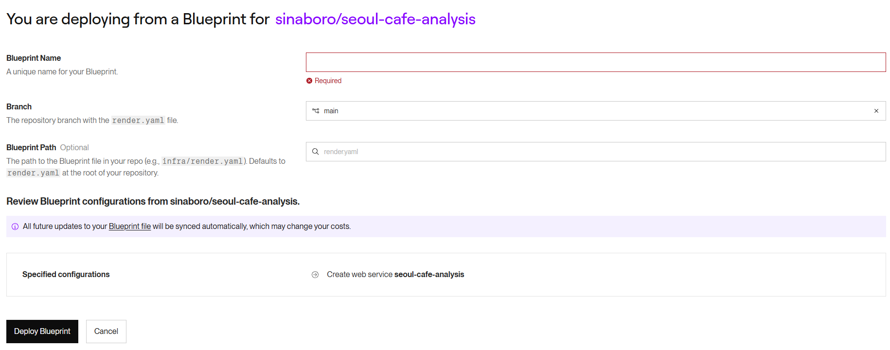
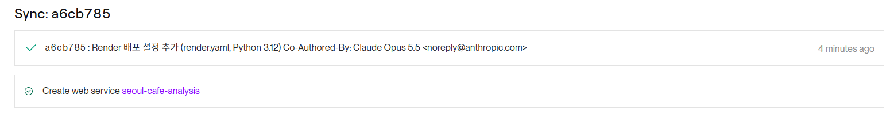
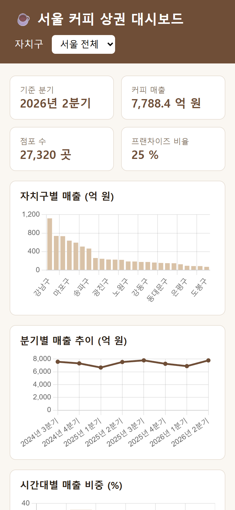

# 8장. 배포하기 - Render 에 올려 공개 주소 만들기

## 학습 목표

- 내 PC 에서만 돌던 서비스를 **인터넷 주소**로 누구나 볼 수 있게 올린다.
- 배포에 필요한 것(설치 목록, 실행 명령, 포트, 데이터, 비밀 값)을 안다.
- GitHub 에 push 하면 자동으로 다시 배포되는 흐름을 이해한다.

## 8-1. 배포란

지금까지는 `uvicorn` 을 **내 PC** 에서 켜서 `127.0.0.1:8000` 으로 봤다. 이 주소는 내 PC 에서만 열린다. **배포**는 같은 프로그램을 인터넷에 연결된 **서버 컴퓨터**에서 켜 두는 일이다.

```text
(내 PC)    uvicorn service.main:app --reload                → http://127.0.0.1:8000   (나만)
(서버)     uvicorn service.main:app --host 0.0.0.0 --port $PORT → https://….onrender.com  (누구나)
```

이 과정은 **Render** 를 쓴다. GitHub 저장소를 연결하면 Render 가 코드를 내려받아 설치하고 실행해 준다. 무료 요금제가 있다.

## 8-2. 배포 전에 확인할 것

| 확인 | 이 프로젝트에서 | 왜 |
|---|---|---|
| 설치 목록 | `requirements.txt` | 서버는 빈 컴퓨터라서 라이브러리를 새로 설치한다 |
| 실행 명령 | `uvicorn service.main:app --host 0.0.0.0 --port $PORT` | `0.0.0.0` = 바깥에서 오는 접속을 받는다. `$PORT` = Render 가 정해 주는 포트 번호 |
| 데이터 | `data/clean/*.csv` 가 저장소에 있다 | 서버에는 내 PC 의 파일이 없다. 저장소에 없는 파일은 서버에도 없다 |
| 비밀 값 | 인증키는 서비스에 필요 없다 | 필요하다면 저장소가 아니라 Render 의 **Environment** 칸에 넣는다 (8-6) |
| 경로 | `Path(__file__)` 기준으로 파일을 찾는다 | 서버의 폴더 위치는 내 PC 와 다르다. `C:\…` 같은 경로를 쓰면 안 된다 |

## 8-3. 배포 설정 파일

Render 가 읽는 설정을 저장소 맨 위에 둔다.

<!-- file: render.yaml -->

```yaml
# render.yaml - Render 배포 설정 (Blueprint)
# Render 대시보드에서 New → Blueprint 로 이 저장소를 고르면 아래 설정으로 웹 서비스를 만든다.
# (New → Web Service 로 직접 만들 때도 아래 값을 그대로 입력하면 된다)
services:
  - type: web
    name: seoul-cafe-analysis          # 주소가 https://seoul-cafe-analysis.onrender.com 처럼 된다 (이미 있으면 뒤에 글자가 붙음)
    runtime: python
    plan: free                         # 무료 요금제 - 접속이 없으면 잠들고, 첫 접속 때 깨어나느라 수십 초 걸린다
    buildCommand: pip install -r requirements.txt
    # Render 가 정해 주는 포트($PORT)로, 바깥에서 접속할 수 있게 0.0.0.0 에서 실행한다
    startCommand: uvicorn service.main:app --host 0.0.0.0 --port $PORT
    envVars:
      - key: PYTHON_VERSION            # .python-version 파일과 같은 버전
        value: "3.12.8"
```

`.python-version` 파일에는 `3.12` 한 줄이 들어 있다. 내 PC 와 같은 파이썬 버전으로 설치하게 한다.

## 8-4. Render 에 배포하기

1. **render.com** 에서 **Get Started**(또는 Sign up) → **GitHub 계정으로 가입**한다.
2. 오른쪽 위 **Dashboard** → **+ New** → **Blueprint**.
3. **GitHub 연결**: Render 가 저장소를 읽을 수 있게 허락한다. 모든 저장소 대신 **이 저장소만** 골라도 된다.
4. 저장소 목록에서 내 저장소를 고르고 **Connect**.
5. **Blueprint Name** 에 이름(예: `seoul-cafe-analysis`)을 적는다. Branch 는 `main`, Blueprint Path 는 비워 둔다. 아래 **Specified configurations** 에 `Create web service …` 가 보이면 `render.yaml` 을 잘 읽은 것이다.



6. **Deploy Blueprint** 를 누른다. 설치·실행에 몇 분 걸린다.



7. 만들어진 웹 서비스(`seoul-cafe-analysis`)를 누르면 위쪽에 `https://seoul-cafe-analysis.onrender.com` 같은 **공개 주소**가 보인다. **Logs** 에서 `Application startup complete` 가 나오면 준비 끝이다.

> Blueprint 메뉴 대신 **+ New → Web Service** 로 만들어도 된다. 그때는 Build Command 에 `pip install -r requirements.txt`, Start Command 에 위 실행 명령, Instance Type 은 **Free** 를 직접 입력한다.

## 8-5. 확인과 업데이트

배포된 주소를 휴대폰으로도 열어 보자. 카드·차트·자치구 선택·추천 표가 모두 동작해야 한다. `/docs` 도 열린다.



**고치고 다시 올리기** - 코드를 고쳐 GitHub 에 push 하면 Render 가 알아서 다시 배포한다. 예를 들어 위 화면은 휴대폰에서 카드 글자가 낱말 중간에 줄이 바뀌던 것을 `style.css` 한 줄(`word-break: keep-all`)로 고쳐 push 한 뒤의 모습이다.

```powershell
git add .
git commit -m "휴대폰 화면 카드 글자 줄바꿈 고침"
git push
```

> **무료 서버는 잠든다.** 15분쯤 접속이 없으면 서버가 쉬고, 다음 첫 접속 때 깨어나느라 수십 초 걸린다. 발표 직전에 주소를 한 번 열어 깨워 두자.

## 8-6. 자주 막히는 곳

| 증상 (Render Logs) | 원인 | 해결 |
|---|---|---|
| `ModuleNotFoundError: No module named 'fastapi'` | `requirements.txt` 에 없다 | 목록에 추가하고 push |
| `No open ports detected` / 접속하면 계속 로딩 | 포트를 `$PORT` 로, 호스트를 `0.0.0.0` 으로 열지 않았다 | 실행 명령 확인 (8-2) |
| `FileNotFoundError: … 커피_최근분기.csv` | 데이터 파일을 저장소에 올리지 않았다 (`.gitignore` 에 걸림 등) | `git ls-files data` 로 확인 후 올린다 |
| `Error loading ASGI app. Could not import module "service.main"` | 실행 명령의 모듈 경로가 다르다 | 저장소 맨 위 기준 `service.main:app` |
| 결제 카드 등록을 요구한다 | 유료 요금제가 골라졌다 | Instance Type 을 **Free** 로 (`plan: free`) |
| 서비스에 인증키가 필요하다 (데이터를 서버에서 받는 경우) | 키를 저장소에 올리면 안 된다 | 웹 서비스 → **Environment** → `SEOUL_API_KEY` 추가. 코드는 `os.environ` 으로 읽는다 (1장 `read_key`) |

## 직접 해 보기

1. `index.html` 의 제목을 내 이름이 들어간 제목으로 바꿔 push 하고, 몇 분 뒤 배포 주소에 반영되는지 확인하자. Render 의 **Events** 에 새 배포가 보인다.
2. 발표 자료 첫 장에 배포 주소를 **QR 코드**로 넣어, 듣는 사람이 휴대폰으로 바로 열어 보게 하자.
