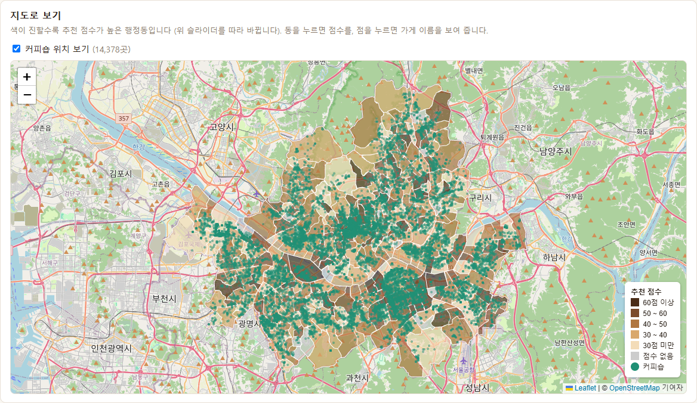
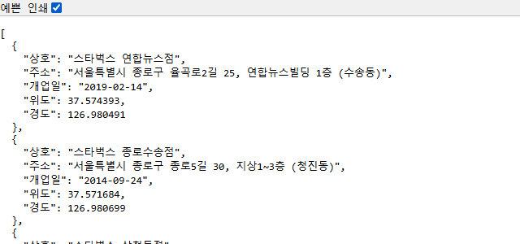
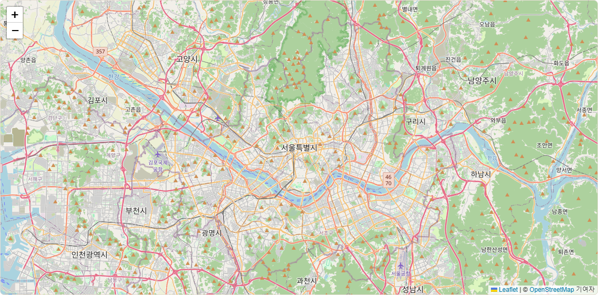
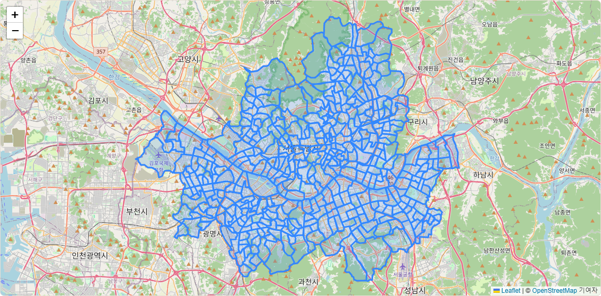
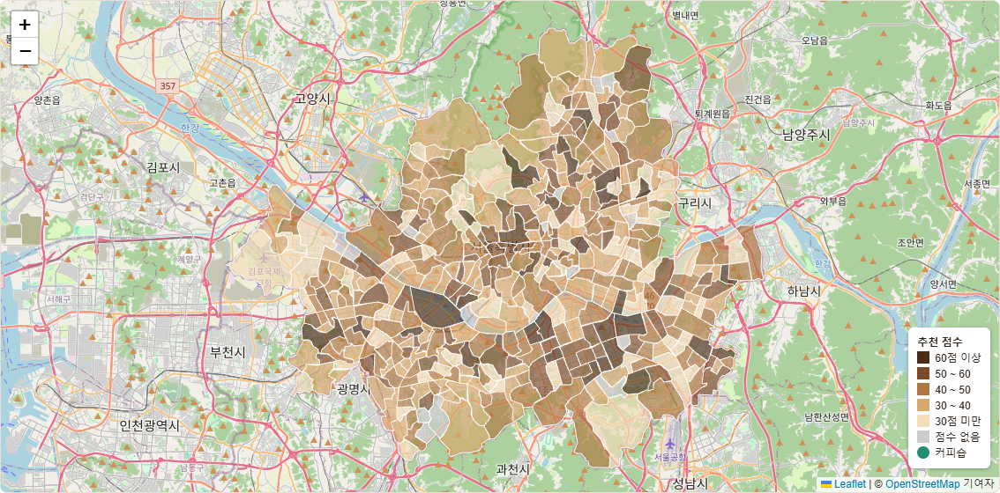
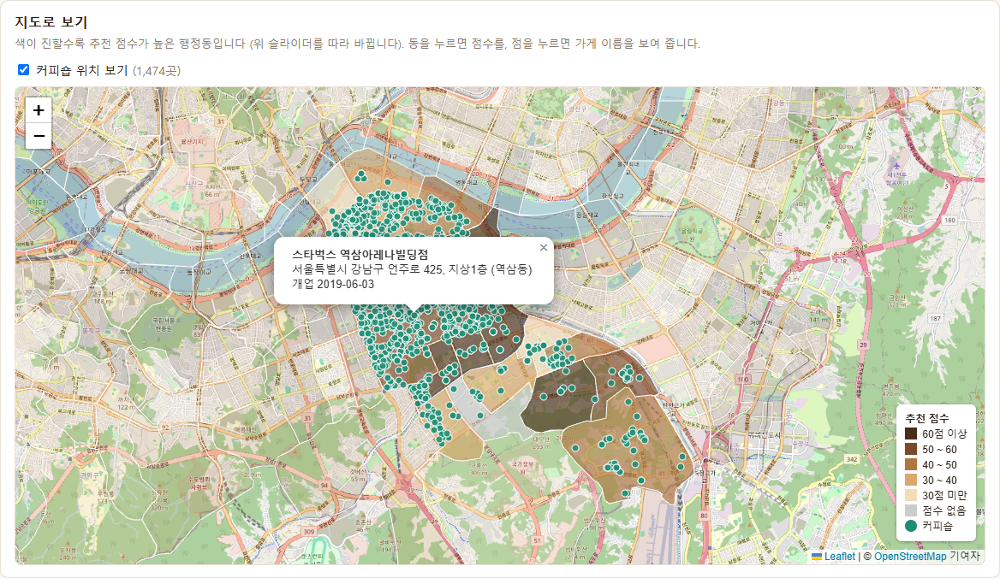
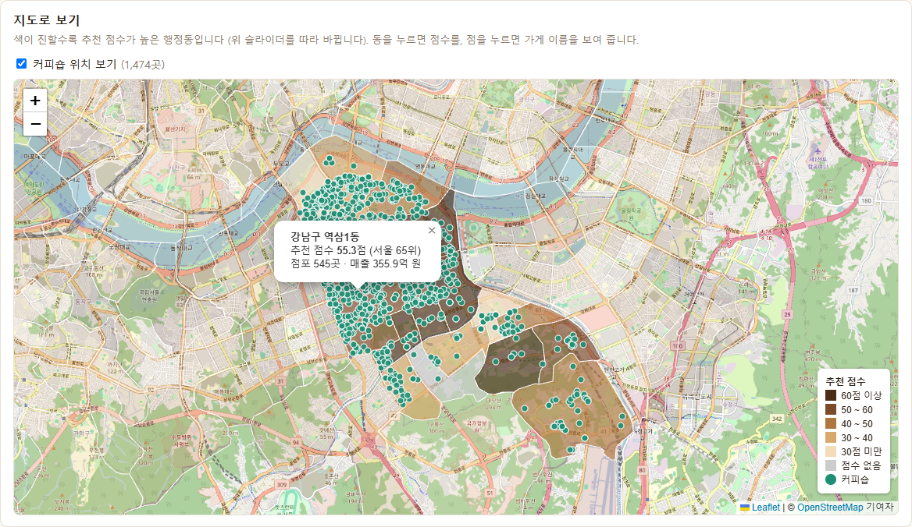

# 9장. 지도 추가 - 커피숍 위치와 추천 점수를 지도로

## 학습 목표

- 웹 지도의 세 가지 재료(**바탕 지도 · 경계선 · 점**)와 **위도·경도**를 이해한다.
- 서울 커피숍 약 1만 4천 곳의 위치를 Open API 로 받아 **좌표계를 바꾼다** (pyproj).
- 행정동 경계 파일(**GeoJSON**)을 준비해 우리 데이터와 **행정동코드**로 잇는다.
- **Leaflet** 으로 행정동을 추천 점수로 색칠하고, 그 위에 커피숍을 점으로 찍는다.
- 자치구 선택 상자와 가중치 슬라이더를 움직이면 지도도 함께 바뀌게 한다.



## 9-1. 어떤 지도를 쓸까

웹 페이지에 넣을 수 있는 지도는 여러 가지다. 이 프로젝트 조건(**HTML/CSS/JS 화면 + FastAPI + Render 무료 배포 + 학생 혼자**)에 맞춰 비교하면 다음과 같다.

| 지도 | 가입·키 | 장점 | 이 프로젝트에서 |
|---|---|---|---|
| **Leaflet + OpenStreetMap** | **필요 없음** | 무료, 가볍다, 자료가 많다, Chart.js 처럼 `<script>` 한 줄 | **이것을 쓴다** |
| 카카오맵 | 앱 키 + 쓸 주소(도메인) 등록 | 국내 가게 이름·로드뷰가 자세하다 | 키 관리, 배포 주소 등록이 번거롭다 |
| 네이버 지도 | 클라우드 가입, 결제 수단 등록 | 국내 지도가 자세하다 | 학생이 쓰기에 가입 절차가 길다 |
| 구글 지도 | 결제 카드 등록 필수 | 세계 지도 | 카드 등록 부담 |
| folium (파이썬) | 필요 없음 | 노트북에서 바로 지도 | 분석 단계에서만. 속은 Leaflet 이다 |

> **왜 Leaflet 인가?** 키가 없으니 "내 PC 에서는 되는데 배포 주소에서는 지도가 안 떠요" 같은 문제가 생기지 않는다. 그리고 우리 지도는 가게 검색이 아니라 **분석 결과를 위치로 보여 주는 것**이 목적이므로 OpenStreetMap 바탕 지도로 충분하다.

## 9-2. 웹 지도의 세 가지 재료

웹 지도는 투명한 종이를 여러 장 겹친 것과 같다. 한 장 한 장을 **층(layer)** 이라고 부른다.

| 층 | 무엇 | 어디서 | 9장에서 만드는 곳 |
|---|---|---|---|
| ① 바탕 지도 (타일) | 도로·강·지명이 그려진 그림 조각 | OpenStreetMap 서버 | 9-6 |
| ② 경계선 (면) | 행정동 425개의 테두리 → 점수로 색칠 | GeoJSON 파일 | 9-4, 9-7, 9-8 |
| ③ 점 | 커피숍 1만 4천 곳 | 휴게음식점 인허가 Open API | 9-3, 9-9 |

### 위도와 경도

지도 위의 한 점은 숫자 두 개로 나타낸다.

- **위도(latitude)**: 남북 위치. 서울은 약 **37.4 ~ 37.7**
- **경도(longitude)**: 동서 위치. 서울은 약 **126.8 ~ 127.2**
- 서울시청 = 위도 37.5665, 경도 126.978

> **순서 주의!** 도구마다 두 숫자의 순서가 다르다. 9장에서 가장 많이 틀리는 곳이다.
>
> - Leaflet: `[위도, 경도]` → `[37.5665, 126.978]`
> - GeoJSON 파일 안: `[경도, 위도]` → `[126.978, 37.5665]`
> - pyproj (`always_xy=True`): `(경도, 위도)` 순서로 돌려준다
>
> 점이 바다나 남극에 찍히면 먼저 순서를 의심하자.

### 좌표계

위도·경도는 지구 전체를 각도로 나타내는 방법(**EPSG:4326**, 흔히 WGS84)이다. 그런데 우리나라 공공데이터 중에는 **미터(m) 단위**의 우리나라용 좌표를 쓰는 것이 많다. 이번에 받을 인허가 데이터도 `X=191152.43, Y=438865.16` 처럼 **EPSG:5174** 라는 좌표계로 되어 있다. 그래서 **위도·경도로 바꾸는 단계**가 필요하다. 이 일은 파이썬 라이브러리 **pyproj** 가 한 줄로 해 준다.

## 9-3. 커피숍 위치 받기

### 어떤 데이터인가

서울 열린데이터광장의 **「서울시 휴게음식점 인허가 정보」**(서비스 이름 `LOCALDATA_072405`). 카페는 구청에 '휴게음식점' 으로 영업 신고를 한다. 이 데이터에는 가게마다 **상호, 주소, 영업 상태, 업태(커피숍 등), 좌표**가 들어 있다. **1장에서 만든 인증키를 그대로 쓴다.** 새로 신청할 것은 없다.

| 열 (영문) | 뜻 | 예 |
|---|---|---|
| `BPLCNM` | 상호 | 스타벅스 세종대로점 |
| `UPTAENM` | 업태 | 커피숍, 다방, 기타 휴게음식점 … |
| `TRDSTATENM` | 영업 상태 | 영업/정상, 폐업, 휴업 |
| `RDNWHLADDR` / `SITEWHLADDR` | 도로명 주소 / 지번 주소 | 서울특별시 중구 세종대로 135-5 … |
| `APVPERMYMD` | 인허가(개업) 날짜 | 2022-10-24 |
| `X`, `Y` | 좌표 (EPSG:5174, 미터) | 198170.5, 451750.2 |

먼저 브라우저 주소창에 아래 주소를 넣어 2줄만 받아 보자. `내키` 자리에 1장에서 받은 인증키를 넣는다.

```text
http://openapi.seoul.go.kr:8088/내키/json/LOCALDATA_072405/1/2/
```

`list_total_count` 가 약 **15만**이다. 폐업한 가게와 커피숍이 아닌 가게까지 모두 들어 있다는 뜻이다. 이 API 는 업태로 거르는 기능이 없으므로 **전부 받은 뒤 pandas 로 거른다.**

### pyproj 설치

```powershell
pip install pyproj
```

> `requirements.txt` 에도 `pyproj` 한 줄을 추가해 두자. 다른 PC 나 서버에서 `pip install -r requirements.txt` 한 번으로 모두 설치된다.

### 스크립트

`analysis/05_매장위치받기.py` 를 만든다. 1장의 `read_key()` 를 다시 쓰고, 나머지는 1장의 `fetch()` 와 거의 같은 흐름이다.

<!-- file: analysis/05_매장위치받기.py -->

```python
"""
05_매장위치받기.py - 서울 커피숍 한 곳 한 곳의 위치(위도·경도)를 받아 지도용 CSV 로 저장한다

── 전체 흐름 ──
① 01 과 같은 인증키로 「서울시 휴게음식점 인허가 정보」(LOCALDATA_072405) 를 1,000줄씩 모두 받는다
   (이 API 는 업태로 거르는 기능이 없어서 커피숍이 아닌 곳까지 전부 온다 → 받은 뒤 pandas 로 거른다)
② 업태가 '커피숍' 이고 지금 '영업' 중인 곳만 남긴다 (폐업한 가게가 훨씬 많다)
③ 좌표 X, Y 는 우리나라 옛 좌표계(EPSG:5174, 단위 m)라서 지도가 쓰는 위도·경도(EPSG:4326)로 바꾼다
④ 주소에서 자치구 이름을 뽑고, 지도에 필요한 열만 data/clean/커피숍_위치.csv 로 저장한다

실행:  python analysis/05_매장위치받기.py      (약 150번 요청 → 2~4분 걸린다)
필요:  pip install pyproj
"""
import time
from pathlib import Path

import pandas as pd
import requests
from pyproj import Transformer

ROOT = Path(__file__).resolve().parent.parent
RAW = ROOT / "data" / "raw"
CLEAN = ROOT / "data" / "clean"
SERVICE = "LOCALDATA_072405"                            # 서울시 휴게음식점 인허가 정보

# 01 에서 만든 인증키 읽기 함수를 그대로 다시 쓴다 (파일 이름이 숫자로 시작해서 import 대신 이렇게 불러온다)
import importlib.util                                   # noqa: E402
_spec = importlib.util.spec_from_file_location("step01", ROOT / "analysis" / "01_데이터받기.py")
_step01 = importlib.util.module_from_spec(_spec)
_spec.loader.exec_module(_step01)
read_key = _step01.read_key


def fetch_all(key):
    """인허가 정보 전체를 1,000줄씩 받아 표 하나로 돌려준다"""
    rows, start = [], 1
    while True:
        end = start + 999
        url = f"http://openapi.seoul.go.kr:8088/{key}/json/{SERVICE}/{start}/{end}/"
        for attempt in range(3):                        # 가끔 응답이 늦으면 두 번 더 시도한다
            try:
                data = requests.get(url, timeout=60).json()
                break
            except (requests.RequestException, ValueError):
                print("   다시 시도", attempt + 1)
                time.sleep(2)
        else:
            raise SystemExit(f"{start}~{end} 줄을 받지 못했습니다. 잠시 뒤 다시 실행하세요.")
        body = data.get(SERVICE)
        if body is None:                                # 인증키 오류 등
            raise SystemExit(f"응답 오류: {data.get('RESULT', data)}")
        rows.extend(body["row"])
        total = body["list_total_count"]
        if start == 1 or end % 20000 == 0 or end >= total:
            print(f"   {min(end, total):,} / {total:,} 줄")
        if end >= total:
            break
        start = end + 1
        time.sleep(0.2)
    return pd.DataFrame(rows)


def main():
    key = read_key()

    # ① 전체 받기 (약 15만 줄)
    print("휴게음식점 인허가 정보 받는 중...")
    df = fetch_all(key)

    # ② 커피숍 + 영업 중만 남기기.  TRDSTATENM(영업상태명): 영업/정상, 휴업, 폐업 ...
    df["UPTAENM"] = df["UPTAENM"].str.strip()
    cafe = df[(df["UPTAENM"] == "커피숍") & (df["TRDSTATENM"].str.contains("영업"))].copy()
    print(f"전체 {len(df):,}곳 중 영업 중인 커피숍 {len(cafe):,}곳")
    cafe.to_csv(RAW / "커피숍_인허가.csv", index=False, encoding="utf-8-sig")   # 원본도 남겨 둔다

    # ③ 좌표 바꾸기. 값 뒤에 공백이 붙어 오므로 숫자로 바꾸고, 좌표가 빈 가게는 뺀다
    cafe["X"] = pd.to_numeric(cafe["X"].str.strip(), errors="coerce")
    cafe["Y"] = pd.to_numeric(cafe["Y"].str.strip(), errors="coerce")
    print(f"좌표가 비어 있어 뺀 곳: {cafe['X'].isna().sum()}곳")
    cafe = cafe.dropna(subset=["X", "Y"])
    # always_xy=True : (x, y) = (동쪽 방향, 북쪽 방향) 순서로 주고받는다 → 결과는 (경도, 위도)
    to_wgs84 = Transformer.from_crs("EPSG:5174", "EPSG:4326", always_xy=True)
    cafe["경도"], cafe["위도"] = to_wgs84.transform(cafe["X"].values, cafe["Y"].values)
    # 서울 바깥으로 튄 좌표(잘못 입력된 값)는 뺀다. 서울은 대략 위도 37.4~37.7, 경도 126.7~127.2
    inside = cafe["위도"].between(37.40, 37.72) & cafe["경도"].between(126.76, 127.19)
    print(f"서울 밖 좌표라 뺀 곳: {(~inside).sum()}곳")
    cafe = cafe[inside]

    # ④ 도로명 주소가 있으면 그것을, 없으면 지번 주소를 쓴다. 자치구는 주소의 두 번째 낱말
    cafe["주소"] = cafe["RDNWHLADDR"].where(cafe["RDNWHLADDR"].str.strip() != "", cafe["SITEWHLADDR"])
    cafe["자치구"] = cafe["주소"].str.split().str[1]
    cafe["개업일"] = cafe["APVPERMYMD"].str.strip()
    out = cafe.rename(columns={"BPLCNM": "상호"})[["상호", "자치구", "주소", "개업일", "위도", "경도"]]
    out = out[out["자치구"].str.endswith("구", na=False)]                     # 주소가 이상한 줄 빼기
    out["위도"], out["경도"] = out["위도"].round(6), out["경도"].round(6)      # 소수 6자리 ≈ 10cm
    out.to_csv(CLEAN / "커피숍_위치.csv", index=False, encoding="utf-8-sig")
    print(f"저장: data/clean/커피숍_위치.csv ({len(out):,}곳)")
    print(out["자치구"].value_counts().head(5).to_string())


if __name__ == "__main__":
    main()
```

### 코드에서 꼭 볼 곳

| 줄 | 설명 |
|---|---|
| `importlib.util.spec_from_file_location(...)` | `01_데이터받기.py` 처럼 이름이 숫자로 시작하는 파일은 `import` 로 못 불러온다. 그래서 파일 경로로 불러와 `read_key` 함수만 꺼내 쓴다 |
| `for attempt in range(3): ... else:` | 150번이나 요청하므로 중간에 한두 번 실패할 수 있다. 세 번까지 다시 시도하고, 그래도 안 되면 멈춘다 (`for` 가 `break` 없이 끝나면 `else` 가 실행된다) |
| `df["UPTAENM"] == "커피숍"` | 업태가 '커피숍' 인 곳만. '다방', '전통찻집' 등은 뺐다 |
| `str.contains("영업")` | 영업 상태 '영업/정상' 만. 폐업한 곳이 훨씬 많다 |
| `pd.to_numeric(..., errors="coerce")` | 좌표 글자 뒤에 빈칸이 붙어 오고, 비어 있는 것도 있다. 숫자로 못 바꾸면 `NaN` 으로 만든 뒤 `dropna` 로 뺀다 |
| `Transformer.from_crs("EPSG:5174", "EPSG:4326", always_xy=True)` | 좌표 변환기. 5174(미터) → 4326(위도·경도). 1만 4천 개를 한 번에 바꾼다 |
| `.between(37.40, 37.72)` | 바꾼 좌표가 서울 범위 안인지 확인. 잘못 입력된 좌표를 걸러 낸다 |
| `str.split().str[1]` | `"서울특별시 강남구 …"` 를 빈칸으로 나눈 두 번째 낱말 = 자치구 |
| `.round(6)` | 소수 6자리면 약 10cm 정밀도. 파일 크기를 줄인다 |

### 실행

```powershell
python analysis/05_매장위치받기.py
```

2~4분 걸린다. 결과는 대략 다음과 같다. (받는 날짜에 따라 숫자는 조금씩 다르다)

```text
휴게음식점 인허가 정보 받는 중...
   1,000 / 148,936 줄
   20,000 / 148,936 줄
   ...
   148,936 / 148,936 줄
전체 148,936곳 중 영업 중인 커피숍 14,707곳
좌표가 비어 있어 뺀 곳: 329곳
서울 밖 좌표라 뺀 곳: 0곳
저장: data/clean/커피숍_위치.csv (14,378곳)
자치구
강남구    1474
서초구     974
중구      886
강서구     876
마포구     840
```

### 좌표가 맞는지 확인하기

변환이 맞았는지 **눈으로** 확인하는 습관을 들이자. `커피숍_위치.csv` 에서 잘 아는 가게 하나를 골라 위도·경도를 OpenStreetMap 이나 구글 지도 검색창에 `37.567529, 126.977743` 처럼 넣어 본다. 아래 예는 '스타벅스 한국프레스센터점(중구 세종대로 124)' 이다. 그 건물 위에 찍히면 성공이다.

```python
import pandas as pd
c = pd.read_csv("data/clean/커피숍_위치.csv")
print(c[c["상호"].str.contains("프레스센터")])
```

> **EPSG:5174 대신 2097 을 쓰면?** 같은 옛 좌표계처럼 보이지만 기준점 보정이 달라 약 **250m** 어긋난다. 지도에서 점이 길 건너편이나 옆 블록에 찍힌다. 그래서 눈으로 확인하는 단계가 꼭 필요하다.

### 숫자가 상권분석의 점포 수와 다르다?

4장까지 쓴 상권분석 데이터의 서울 커피 점포 수는 약 **2만 7천**인데, 이번 데이터의 영업 중인 커피숍은 약 **1만 4천**이다. 잘못된 것이 아니라 **기준이 다르다.**

| | 상권분석 (1~4장) | 휴게음식점 인허가 (9장) |
|---|---|---|
| 무엇을 셌나 | '커피-음료' 업종으로 분류된 점포 (주스·차 가게, 일반음식점으로 신고한 카페 포함) | 휴게음식점으로 신고하고 업태를 '커피숍' 으로 적은 곳만 |
| 위치 | 행정동 단위 합계 | 가게 한 곳 한 곳의 좌표 |

그래서 이 장의 점은 **"커피숍이 어디에 몰려 있는지" 를 보여 주는 용도**로 쓰고, 매출·점수 계산은 지금처럼 상권분석 데이터로 한다. 보고서에도 이 차이를 한 줄 적어 두자.

## 9-4. 행정동 경계 준비하기 (GeoJSON)

### GeoJSON 이란

지도 위의 모양(점·선·면)과 그 이름표를 **JSON 글자**로 적은 파일이다. 행정동 하나는 이렇게 생겼다.

```json
{
  "type": "Feature",
  "properties": { "행정동코드": "11110530", "자치구": "종로구", "행정동": "사직동" },
  "geometry": {
    "type": "MultiPolygon",
    "coordinates": [[[[126.97689, 37.57565], [126.97703, 37.56919], ... ]]]
  }
}
```

- `properties` = 이름표. 우리가 원하는 정보를 넣을 수 있다. 여기서는 **행정동코드**가 우리 데이터와 잇는 열쇠다.
- `geometry` = 모양. 면(`Polygon`, 여러 조각이면 `MultiPolygon`)의 꼭짓점을 **[경도, 위도]** 순서로 나열한다. 첫 점과 끝 점이 같아 닫힌 모양이 된다.
- 이런 Feature 수백 개를 `{"type": "FeatureCollection", "features": [...]}` 로 묶으면 한 파일이 된다.

### 어디서 받나

GitHub 저장소 **vuski/admdongkor** 가 통계청(SGIS) 행정동 경계를 GeoJSON 으로 정리해 공개한다. 날짜별 폴더(`ver20210101`, `ver20260701` …)에 전국 파일이 하나씩 있다. 출처를 밝히면 자유롭게 쓸 수 있다(공공누리 1유형 + CC BY 4.0). 화면 아래에 출처를 꼭 적자 (9-6).

### 어느 날짜 경계를 쓸까 (중요)

행정동은 가끔 나뉘거나 합쳐지고 이름이 바뀐다. 그런데 **서울시 상권분석 데이터는 2021년 초의 행정동 구분을 지금도 그대로 쓴다.** 최신 경계를 쓰면 다음 세 동의 짝이 맞지 않아 색이 빈다.

| 상권분석 데이터 (옛 구분) | 최신 경계 |
|---|---|
| 강동구 상일동 `11740520` | 상일제1동 · 상일제2동 으로 나뉨 |
| 강남구 일원2동 `11680740` | 개포3동 으로 바뀜 |
| 동대문구 용신동 `11230536` | 경계·코드가 바뀜 |

그래서 **데이터와 같은 `ver20210101`** 을 쓴다. 스크립트 끝에서 "경계 파일에 없는 곳: 0개" 인지 확인하게 해 두었다.

> **코드 자릿수도 확인하자.** 경계 파일의 `adm_cd2` 는 10자리(`1111053000`), 우리 데이터의 행정동코드는 8자리(`11110530`)다. 앞 8자리를 잘라 맞춘다. 다른 경계 파일을 쓸 때도 이것부터 확인하자.

### 스크립트

`analysis/06_행정동경계.py` 를 만든다.

<!-- file: analysis/06_행정동경계.py -->

```python
"""
06_행정동경계.py - 지도에 색을 칠할 '서울 행정동 경계선' 파일(GeoJSON)을 준비한다

── 전체 흐름 ──
① 전국 행정동 경계 GeoJSON(약 35MB)을 GitHub 저장소 vuski/admdongkor 에서 받는다
② 서울(행정동 코드가 11 로 시작)만 남긴다
③ 좌표를 소수 5자리(약 1m)로 줄여 파일 크기를 줄인다 → 브라우저가 빨리 받는다
④ 우리 상권 데이터와 같은 8자리 행정동코드를 붙여 data/clean/서울_행정동.geojson 으로 저장한다

GeoJSON 이란?  지도 위의 모양(점·선·면)과 그 이름표를 JSON 글자로 적은 파일.
               { "type": "FeatureCollection", "features": [ {모양 하나}, {모양 하나}, ... ] }

실행:  python analysis/06_행정동경계.py
출처 표기(꼭 화면에 남길 것): 통계청 SGIS 행정동 경계(공공누리 1유형), 가공 vuski/admdongkor (CC BY 4.0)
"""
import json
from pathlib import Path

import pandas as pd
import requests

ROOT = Path(__file__).resolve().parent.parent
CLEAN = ROOT / "data" / "clean"
# 어느 날짜 기준 경계를 쓸까?  서울시 상권분석 데이터는 2021년 초의 행정동 구분을 지금도 그대로 쓴다.
# (그 뒤 상일동 → 상일1·2동, 일원2동 → 개포3동 처럼 바뀐 동이 있다)
# 최신 경계(ver2026...)를 쓰면 3개 동이 짝을 못 찾아 색이 비므로, 데이터와 같은 2021년 1월 경계를 쓴다.
VERSION = "ver20210101"
URL = ("https://raw.githubusercontent.com/vuski/admdongkor/master/"
       f"{VERSION}/HangJeongDong_{VERSION}.geojson")


def round_coords(coords):
    """[[경도, 위도], ...] 처럼 겹겹이 든 목록을 끝까지 따라가며 숫자를 소수 5자리로 줄인다"""
    if isinstance(coords[0], (int, float)):              # 맨 안쪽: [경도, 위도] 한 점
        return [round(coords[0], 5), round(coords[1], 5)]
    return [round_coords(c) for c in coords]             # 아직 목록이면 한 겹 더 들어간다


def main():
    # ① 전국 파일 받기
    print("전국 행정동 경계 받는 중 (약 35MB)...")
    geo = requests.get(URL, timeout=180).json()
    print(f"전국 행정동 {len(geo['features']):,}개")

    # ② 서울만.  properties 예: {"adm_nm": "서울특별시 종로구 사직동", "adm_cd2": "1111053000", ...}
    seoul = [f for f in geo["features"] if f["properties"]["adm_cd2"].startswith("11")]

    # ④ 우리 데이터의 행정동코드(8자리)와 맞추기: adm_cd2(10자리)의 앞 8자리
    for f in seoul:
        p = f["properties"]
        names = p["adm_nm"].split()                       # ["서울특별시", "종로구", "사직동"]
        f["properties"] = {"행정동코드": p["adm_cd2"][:8], "자치구": names[1], "행정동": names[2]}
        f["geometry"]["coordinates"] = round_coords(f["geometry"]["coordinates"])   # ③

    out = {"type": "FeatureCollection", "features": seoul}
    path = CLEAN / "서울_행정동.geojson"
    path.write_text(json.dumps(out, ensure_ascii=False, separators=(",", ":")), encoding="utf-8")
    print(f"저장: {path.relative_to(ROOT)} (행정동 {len(seoul)}개, {path.stat().st_size / 1e6:.1f}MB)")

    # 확인: 상권 데이터의 행정동코드가 경계 파일에 모두 있는가?
    last = pd.read_csv(CLEAN / "커피_최근분기.csv", dtype={"행정동코드": str})
    codes = {f["properties"]["행정동코드"] for f in seoul}
    missing = last[~last["행정동코드"].isin(codes)]
    print(f"상권 데이터 행정동 {len(last)}개 중 경계 파일에 없는 곳: {len(missing)}개")
    if len(missing):
        print(missing[["자치구", "행정동", "행정동코드"]].to_string(index=False))


if __name__ == "__main__":
    main()
```

| 줄 | 설명 |
|---|---|
| `startswith("11")` | 행정동 코드의 앞 두 자리 `11` = 서울특별시 |
| `round_coords()` | 꼭짓점 좌표가 목록 안의 목록 안의 목록 … 으로 들어 있어 몇 겹인지 모른다. 함수가 **자기 자신을 다시 부르며**(재귀) 맨 안쪽 숫자까지 들어가 소수 5자리(약 1m)로 줄인다 |
| `f["properties"] = {...}` | 이름표를 우리가 쓰기 좋게 한글 열 세 개로 바꾼다 |
| `separators=(",", ":")` | JSON 을 저장할 때 빈칸을 빼서 크기를 줄인다 |

```powershell
python analysis/06_행정동경계.py
```

```text
전국 행정동 경계 받는 중 (약 35MB)...
전국 행정동 3,494개
저장: data\clean\서울_행정동.geojson (행정동 425개, 0.5MB)
상권 데이터 행정동 421개 중 경계 파일에 없는 곳: 0개
```

35MB 전국 파일이 **0.5MB** 서울 파일이 되었다. 화면이 받기에 알맞은 크기다.

## 9-5. API 세 개 추가하기 (FastAPI)

화면(JS)은 파일을 직접 못 읽는다. 5장처럼 **서버가 주소(API)로 건네준다.** `service/main.py` 에 세 곳을 더한다.

| 주소 | 돌려주는 것 | 화면에서 쓰는 곳 |
|---|---|---|
| `/api/stores?gu=강남구` | 커피숍 목록 (상호, 주소, 개업일, 위도, 경도) | 점 찍기 (9-9) |
| `/api/dong-geo` | `서울_행정동.geojson` 파일 그대로 | 경계선 (9-7) |
| `/api/map?w_sales=35&...` | 행정동코드마다 추천 점수·순위 | 색칠 (9-8) |

**① 맨 위 import 에 두 줄 추가**

```python
from fastapi import FastAPI, HTTPException
from fastapi.middleware.gzip import GZipMiddleware     # 추가: 응답 압축
from fastapi.responses import FileResponse             # 추가: 파일을 그대로 보내기
from fastapi.staticfiles import StaticFiles
```

**② `app = FastAPI(...)` 줄을 아래처럼 바꾼다** (데이터 읽기 + 압축 켜기)

```python
# ⑤ 지도용 데이터 (05·06 스크립트가 만든 파일)
STORES = pd.read_csv(CLEAN / "커피숍_위치.csv", dtype={"개업일": str})
DONG_GEO = CLEAN / "서울_행정동.geojson"

app = FastAPI(title="서울 커피 상권 분석 API")
# 응답이 1KB 보다 크면 압축(gzip)해서 보낸다. 커피숍 1만 4천 곳 목록(약 2.7MB)이 약 1/5(0.6MB) 로 줄어든다
app.add_middleware(GZipMiddleware, minimum_size=1000)
```

**③ 맨 아래 `app.mount(...)` 줄 바로 위에 함수 세 개 추가**

```python
# ⑤ 지도 ─────────────────────────────────────────────
@app.get("/api/stores")
def stores(gu: str = ""):
    """영업 중인 커피숍 위치. gu 를 주면 그 자치구만 (서울 전체는 약 1만 4천 곳)"""
    d = pick_gu(STORES, gu)
    return d[["상호", "주소", "개업일", "위도", "경도"]].to_dict(orient="records")


@app.get("/api/dong-geo")
def dong_geo():
    """서울 행정동 경계선(GeoJSON). 파일을 그대로 보낸다"""
    return FileResponse(DONG_GEO, media_type="application/geo+json")


@app.get("/api/map")
def map_scores(w_sales: float = 35, w_demand: float = 25, w_growth: float = 20, w_stable: float = 20):
    """행정동마다 지도 색에 쓸 값. {행정동코드: {추천점수, 점포수, ...}} 모양으로 돌려준다
    슬라이더 가중치가 같으면 /api/score 의 표와 같은 점수다 (점포 10곳 미만 동은 빠진다)"""
    weights = {"매출": w_sales, "수요": w_demand, "성장": w_growth, "안정": w_stable}
    if sum(weights.values()) <= 0:
        raise HTTPException(status_code=400, detail="가중치를 하나 이상 0 보다 크게 주세요")
    ranked = startup_score(SCORE_BASE, weights)
    ranked["순위"] = range(1, len(ranked) + 1)                 # 점수 높은 순으로 1, 2, 3, ...
    ranked["매출_억원"] = ranked["매출액"] / EOK
    cols = ["행정동코드", "순위", "추천점수", "점포수", "매출_억원"]
    return ranked[cols].round(1).set_index("행정동코드").to_dict(orient="index")
```

> **왜 `mount` 위에 두나?** 6장에서 본 것처럼 `app.mount("/", ...)` 는 "나머지 모든 주소는 화면 파일" 이라는 뜻이다. 그 아래에 API 를 두면 화면 파일 쪽이 먼저 주소를 가져가 버린다.

**`/api/map` 의 모양**: `/api/score` 는 표(목록)를 돌려주지만, 지도는 "이 동의 점수가 몇인가?" 를 코드로 바로 찾아야 한다. 그래서 `set_index("행정동코드").to_dict(orient="index")` 로 **코드를 열쇠로 하는 사전**을 만든다.

```json
{ "11650580": {"순위": 1, "추천점수": 83.6, "점포수": 15.0, "매출_억원": 8.1},
  "11680720": {"순위": 2, "추천점수": 82.2, "점포수": 12.0, "매출_억원": 9.2}, ... }
```

### 확인

서버를 다시 켜고(`uvicorn service.main:app --reload`) 브라우저에서 주소 세 개를 열어 보자.

- `http://127.0.0.1:8000/api/stores?gu=종로구` → 가게 목록
- `http://127.0.0.1:8000/api/dong-geo` → 아주 긴 JSON (경계선)
- `http://127.0.0.1:8000/api/map` → 행정동코드별 점수



`/docs` 에도 세 주소가 새로 보인다.

## 9-6. 화면 1단계 - 빈 지도 띄우기

이제 화면이다. 지도 코드는 **새 파일 `service/static/map.js`** 에 따로 쓴다. 6장의 `app.js` 는 거의 건드리지 않으므로, 지도에서 실수해도 기존 차트는 멀쩡하다.

**① `index.html` 의 `<head>` 안, Chart.js 줄 아래에 Leaflet 두 줄 추가**

```html
  <!-- 지도 라이브러리 Leaflet: 모양(css)과 기능(js) 두 파일을 함께 불러온다 -->
  <link rel="stylesheet" href="https://cdn.jsdelivr.net/npm/leaflet@1.9.4/dist/leaflet.css">
  <script src="https://cdn.jsdelivr.net/npm/leaflet@1.9.4/dist/leaflet.js"></script>
```

> **css 를 빼먹으면** 지도 조각이 흩어지고 +/- 단추가 이상하게 보인다. 두 줄 모두 필요하다.

**② `</main>` 바로 위(추천 표 `</section>` 다음)에 지도 칸 추가**

```html
    <!-- ⑤ 지도 (9장) -->
    <section class="panel">
      <h2>지도로 보기</h2>
      <p class="hint">색이 진할수록 추천 점수가 높은 행정동입니다 (위 슬라이더를 따라 바뀝니다). 동을 누르면 점수를, 점을 누르면 가게 이름을 보여 줍니다.</p>
      <label class="map-option"><input type="checkbox" id="show-stores" checked> 커피숍 위치 보기 <span id="store-count"></span></label>
      <div id="map"></div>   <!-- Leaflet 이 이 상자 안에 지도를 그린다. 높이를 꼭 정해 줘야 보인다(style.css) -->
    </section>
```

**③ `app.js` 줄 아래에 `map.js` 추가**

```html
  <script src="app.js"></script>
  <script src="map.js"></script>   <!-- 지도 (app.js 의 getJSON 을 쓰므로 app.js 다음에) -->
```

**④ 출처 표기: `<footer>` 에 한 줄 더**

```html
  <footer>데이터: 서울 열린데이터광장 「서울시 상권분석서비스」 (추정매출·점포·인구, 행정동) · 공공누리 제1유형<br>
    커피숍 위치: 서울 열린데이터광장 「서울시 휴게음식점 인허가 정보」 · 행정동 경계: 통계청 SGIS(공공누리 제1유형), 가공 vuski/admdongkor (CC BY 4.0)</footer>
```

**⑤ `style.css` 의 `footer { ... }` 줄 위에 추가**

```css
/* ⑤ 지도: Leaflet 지도는 상자 높이가 0 이면 아무것도 안 보이므로 높이를 꼭 준다 */
#map { height: 560px; border-radius: 8px; border: 1px solid var(--line); }
.map-option { display: inline-block; margin-bottom: 10px; font-size: 14px; }
#store-count { color: #8a7a6b; }
.legend { background: #fff; padding: 8px 10px; border-radius: 6px; font-size: 12px; line-height: 18px;
          box-shadow: 0 1px 4px rgba(0, 0, 0, .3); }
.legend i { display: inline-block; width: 14px; height: 14px; margin-right: 6px; vertical-align: -2px; }
```

그리고 맨 아래 `@media (max-width: 760px) { ... }` 안에 `#map { height: 420px; }` 한 줄을 넣으면 휴대폰에서 지도가 조금 낮아진다.

**⑥ `service/static/map.js` 새로 만들기 (1단계)**

```javascript
/* map.js 1단계 - 빈 지도 띄우기 */
const SEOUL_CENTER = [37.5665, 126.978];      // 서울시청 (위도, 경도) - Leaflet 은 항상 [위도, 경도] 순서

// 지도 만들기: "map" 은 index.html 의 <div id="map">. setView(가운데, 확대 정도)
const map = L.map("map", { preferCanvas: true, zoomSnap: 0.5 }).setView(SEOUL_CENTER, 11);

// 바탕 지도(타일) 깔기: 작은 그림 조각을 {z}확대/{x}/{y} 주소로 받아 이어 붙인다
L.tileLayer("https://tile.openstreetmap.org/{z}/{x}/{y}.png", {
  maxZoom: 19,
  attribution: '&copy; <a href="https://www.openstreetmap.org/copyright">OpenStreetMap</a> 기여자',  // 저작권 표시는 지우면 안 된다
}).addTo(map);
```

| 코드 | 뜻 |
|---|---|
| `L` | Leaflet 의 모든 기능이 들어 있는 이름. `leaflet.js` 를 불러오면 생긴다 |
| `L.map("map", {...})` | `id="map"` 인 상자에 지도를 만든다 |
| `preferCanvas: true` | 점·면을 캔버스(그림판 하나)에 그린다. 점이 1만 개여도 빠르다 |
| `zoomSnap: 0.5` | 확대 단계를 반 칸씩. 자치구에 맞춰 확대할 때 더 꼭 맞는다 |
| `setView(가운데, 11)` | 처음 보여 줄 가운데와 확대 정도. 숫자가 클수록 가까이 (서울 전체 ≈ 11, 동네 ≈ 15) |
| `L.tileLayer(주소, {...}).addTo(map)` | 바탕 지도 층을 만들어 지도에 올린다 |

저장하고 브라우저를 **새로 고침**(Ctrl + F5)하면 맨 아래에 서울 지도가 보인다. 마우스 휠로 확대·축소하고 끌어서 움직여 보자.



> **회색 상자만 보이면** F12 → Console 탭을 열어 빨간 오류를 읽는다. `L is not defined` 는 ① 의 Leaflet 줄이 없거나 `map.js` 보다 아래에 있는 것이다. 아무것도 안 보이면 ⑤ 의 `#map { height: ... }` 를 확인한다.

## 9-7. 화면 2단계 - 행정동 경계선 올리기

`map.js` 맨 아래에 이어서 쓴다.

```javascript
// ── 2단계: 행정동 경계선 올리기 ──
let dongLayer = null;                         // 경계선 층 (다른 함수에서도 쓰려고 바깥에 둔다)

async function loadDongs() {
  const geo = await getJSON("/api/dong-geo");  // getJSON 은 app.js 에 있는 함수
  dongLayer = L.geoJSON(geo).addTo(map);       // GeoJSON 을 그대로 주면 Leaflet 이 모양을 그려 준다
}
loadDongs();
```

- `getJSON` 은 6장 `app.js` 에서 만든 함수다. `index.html` 에서 `app.js` 를 먼저 불러왔으므로 `map.js` 에서도 쓸 수 있다.
- `L.geoJSON(geo)` 한 줄이면 GeoJSON 안의 [경도, 위도] 를 Leaflet 이 알아서 [위도, 경도] 로 바꿔 그린다.



## 9-8. 화면 3단계 - 추천 점수로 색칠하기

이제 동마다 점수에 따라 다른 색을 칠한다. 이런 지도를 **단계 구분도(choropleth, 코로플레스)** 라고 한다. 바뀌는 곳이 여러 군데라, **`map.js` 전체를 아래 내용으로 바꾼다.**

```javascript
/* map.js 3단계 - 행정동을 추천 점수로 색칠하기 (1·2단계 + 색칠, 말풍선, 범례, 슬라이더) */
const SEOUL_CENTER = [37.5665, 126.978];
const map = L.map("map", { preferCanvas: true, zoomSnap: 0.5 }).setView(SEOUL_CENTER, 11);
L.tileLayer("https://tile.openstreetmap.org/{z}/{x}/{y}.png", {
  maxZoom: 19,
  attribution: '&copy; <a href="https://www.openstreetmap.org/copyright">OpenStreetMap</a> 기여자',
}).addTo(map);

let dongLayer = null;
let scores = {};           // { "11110515": {순위, 추천점수, 점포수, 매출_억원}, ... }

// 점수 → 색. 높을수록 진한 커피색. 점수가 없는 동(점포 10곳 미만)은 회색
const STEPS = [
  { min: 60, color: "#4a2c17", label: "60점 이상" },
  { min: 50, color: "#7b4a2a", label: "50 ~ 60" },
  { min: 40, color: "#b0763f", label: "40 ~ 50" },
  { min: 30, color: "#d9a86c", label: "30 ~ 40" },
  { min: 0,  color: "#f3dcb8", label: "30점 미만" },
];
function colorOf(score) {
  if (score === undefined) return "#cccccc";
  return STEPS.find(s => score >= s.min).color;      // 위에서부터 보며 처음 맞는 구간의 색
}

// 동 하나(feature)의 모양: 안쪽 색, 투명도, 테두리 색·두께
function dongStyle(feature) {
  const s = scores[feature.properties["행정동코드"]];
  return { fillColor: colorOf(s && s["추천점수"]), fillOpacity: 0.65, color: "#ffffff", weight: 1 };
}

// 동을 눌렀을 때 뜨는 말풍선 내용
function dongPopup(feature) {
  const p = feature.properties;
  const s = scores[p["행정동코드"]];
  if (!s) return `<b>${p["자치구"]} ${p["행정동"]}</b><br>커피 점포가 10곳 미만이라 점수 없음`;
  return `<b>${p["자치구"]} ${p["행정동"]}</b><br>
    추천 점수 <b>${s["추천점수"]}</b>점 (서울 ${s["순위"]}위)<br>
    점포 ${s["점포수"]}곳 · 매출 ${s["매출_억원"]}억 원`;
}

async function loadDongs() {
  const geo = await getJSON("/api/dong-geo");
  dongLayer = L.geoJSON(geo, {
    style: dongStyle,                                                              // 동마다 색
    onEachFeature: (feature, layer) => layer.bindPopup(() => dongPopup(feature)),  // 동마다 말풍선
  }).addTo(map);
}

// 점수 받아서 다시 칠하기. 가중치는 app.js 와 같은 슬라이더 값
async function loadScores() {
  const w = id => document.getElementById(id).value;
  const url = `/api/map?w_sales=${w("w-sales")}&w_demand=${w("w-demand")}` +
              `&w_growth=${w("w-growth")}&w_stable=${w("w-stable")}`;
  try {
    scores = await getJSON(url);
  } catch (e) {
    scores = {};                                       // 가중치가 모두 0 이면 모두 회색
  }
  dongLayer.setStyle(dongStyle);                       // 모든 동을 새 점수로 다시 칠한다
}

// 오른쪽 아래 범례(색 설명)
const legend = L.control({ position: "bottomright" });
legend.onAdd = () => {
  const div = L.DomUtil.create("div", "legend");
  div.innerHTML = "<b>추천 점수</b><br>" +
    STEPS.map(s => `<i style="background:${s.color}"></i>${s.label}`).join("<br>") +
    '<br><i style="background:#cccccc"></i>점수 없음';
  return div;
};
legend.addTo(map);

async function initMap() {
  await loadDongs();      // 경계선을 먼저 올리고
  await loadScores();     // 그다음 색칠
}
document.querySelectorAll(".sliders input").forEach(input => input.addEventListener("change", loadScores));
initMap();
```

### 동작 순서

```text
initMap()
 ├─ loadDongs()   /api/dong-geo 로 경계선을 받아 그린다. 이때 scores 는 비어 있어 모두 회색
 └─ loadScores()  /api/map 으로 점수를 받아 scores 에 넣고 → dongLayer.setStyle(dongStyle)
                  → Leaflet 이 동 425개마다 dongStyle(동) 을 불러 색을 다시 정한다

슬라이더를 움직였다 놓으면 → loadScores() 만 다시 → 색이 바뀐다
```

| 코드 | 뜻 |
|---|---|
| `L.geoJSON(geo, { style: dongStyle })` | 동마다 `dongStyle(동)` 을 불러 그 결과로 색칠한다 |
| `scores[feature.properties["행정동코드"]]` | 경계선의 이름표(행정동코드)로 점수 사전에서 그 동의 점수를 찾는다 = **두 데이터를 잇는 곳** |
| `s && s["추천점수"]` | 점수가 없으면(`undefined`) 그대로 `undefined` → 회색. 없을 때 오류가 나지 않게 한다 |
| `STEPS.find(s => score >= s.min)` | 큰 구간부터 보며 처음 맞는 것. 72점 → 60 이상 구간 |
| `bindPopup(() => dongPopup(feature))` | 글자 대신 **함수**를 주면 누를 때마다 새로 만든다 → 슬라이더를 바꾼 뒤에도 최신 점수가 나온다 |
| `L.control` / `onAdd` | 지도 귀퉁이에 HTML 상자(범례)를 붙인다 |

> **색 구간은 어떻게 정했나?** 서울 동들의 점수를 줄 세워 보면 하위 10% 가 약 27점, 가운데가 약 42점, 상위 10% 가 약 59점이었다. 그래서 30·40·50·60 으로 나눴다. 구간을 잘못 잡으면 지도가 한 가지 색으로만 보인다. 내 데이터의 분포(`describe()`)를 보고 정하자.



슬라이더(예: '매출 성장' 을 100 으로)를 움직였다 놓으면 지도 색이 바뀌는지 확인하자.

## 9-9. 화면 4단계 - 커피숍 점 찍기

이제 1만 4천 곳의 커피숍을 점으로 찍는다. 점 하나는 `L.circleMarker([위도, 경도], 모양)` 이다.

```javascript
const look = { radius: 4, color: "#ffffff", weight: 1, fillColor: "#1f8f74", fillOpacity: 0.9 };
const dot = L.circleMarker([37.5675, 126.9777], look).bindPopup("스타벅스 한국프레스센터점");
```

목록 전체는 `rows.map(r => L.circleMarker(...))` 로 점 배열을 만들고, `L.layerGroup(점 배열)` 로 묶어 한 층으로 올린다. 층으로 묶어 두면 `map.removeLayer(층)` 한 번에 모두 지울 수 있다.

> **점이 너무 많을 때.** 서울 전체(1만 4천 곳)를 크고 진한 점으로 찍으면 지도가 초록색으로 뒤덮여 색칠이 안 보인다. 그래서 **서울 전체일 때는 아주 작고 흐린 점**, 자치구 하나일 때는 크고 또렷한 점으로 찍는다. 그리고 `preferCanvas: true` 덕분에 점이 많아도 버벅이지 않는다. (점을 묶어 숫자로 보여 주는 `Leaflet.markercluster` 플러그인도 있다. '직접 해 보기' 참고)

가게 이름은 사람이 신고한 글자라 `<` `>` 같은 기호가 들어 있을 수 있다. 말풍선(HTML)에 그대로 넣으면 화면이 깨지므로 `esc()` 함수로 바꿔 넣는다.

## 9-10. 화면 5단계 - 자치구 선택과 연결하기 (완성)

마지막으로 자치구 상자와 연결한다.

- 자치구를 고르면 → 그 구의 동들이 화면에 꽉 차게 **확대**(`fitBounds`)하고, 그 구의 커피숍만 다시 찍는다.
- 다른 구의 동은 **흐리게**(투명도 0.15) 해서 고른 구가 눈에 띄게 한다.
- '커피숍 위치 보기' 를 끄면 점을 지운다.

4·5단계를 더한 **`map.js` 완성본**이다. 3단계 파일을 이 내용으로 바꾼다.

<!-- file: service/static/map.js -->

```javascript
/* map.js - Leaflet 으로 '행정동 추천 점수 색칠 지도' 와 '커피숍 위치 점' 을 그린다 (9장)
   ── 전체 흐름 ──
   ① 지도를 만들고 바탕 지도(OpenStreetMap 타일)를 깐다
   ② 행정동 경계선(/api/dong-geo)을 한 번 받아 지도에 올린다
   ③ 동마다 추천 점수(/api/map)를 받아 색을 칠한다 → 슬라이더를 움직이면 다시 칠한다
   ④ 커피숍 위치(/api/stores)를 작은 동그라미로 찍는다 → 자치구를 바꾸면 그 구만 찍고 확대한다
   app.js 는 건드리지 않고, 같은 자치구 상자·슬라이더에 이 파일이 따로 이벤트를 붙인다. */

const SEOUL_CENTER = [37.5665, 126.978];      // 서울시청 (위도, 경도) - Leaflet 은 항상 [위도, 경도] 순서
const guBox = document.getElementById("gu-select");
const storeCheck = document.getElementById("show-stores");

// ① 지도 만들기. preferCanvas: 점 1만 개도 빠르게 그리도록 SVG 대신 캔버스에 그린다
//               zoomSnap: 0.5 → 확대 단계를 반 칸씩 (자치구에 딱 맞게 확대하려고)
const map = L.map("map", { preferCanvas: true, zoomSnap: 0.5 }).setView(SEOUL_CENTER, 11);   // 11 = 확대 정도(클수록 가까이)
L.tileLayer("https://tile.openstreetmap.org/{z}/{x}/{y}.png", {
  maxZoom: 19,
  attribution: '&copy; <a href="https://www.openstreetmap.org/copyright">OpenStreetMap</a> 기여자',  // 저작권 표시는 지우면 안 된다
}).addTo(map);

let dongLayer = null;      // 행정동 경계 층 (② 에서 만든다)
let storeLayer = null;     // 커피숍 점 층 (④ 에서 만든다)
let scores = {};           // { "11110515": {순위, 추천점수, 점포수, 매출_억원}, ... }

// 가게 이름에 < > 같은 글자가 있어도 화면이 깨지지 않게 바꿔 준다
function esc(text) {
  return String(text).replace(/[&<>"]/g, c => ({ "&": "&amp;", "<": "&lt;", ">": "&gt;", '"': "&quot;" }[c]));
}

// 점수 → 색. 높을수록 진한 커피색. 점수가 없는 동(점포 10곳 미만)은 회색
// 구간은 점수 분포를 보고 정했다: 서울 동들의 점수는 대략 30~60점에 몰려 있다
const STEPS = [
  { min: 60, color: "#4a2c17", label: "60점 이상" },
  { min: 50, color: "#7b4a2a", label: "50 ~ 60" },
  { min: 40, color: "#b0763f", label: "40 ~ 50" },
  { min: 30, color: "#d9a86c", label: "30 ~ 40" },
  { min: 0,  color: "#f3dcb8", label: "30점 미만" },
];
function colorOf(score) {
  if (score === undefined) return "#cccccc";
  return STEPS.find(s => score >= s.min).color;
}

// 동 하나(feature)를 어떤 모양으로 그릴지: 안쪽 색, 테두리 색·두께, 투명도
// 자치구를 골랐으면 다른 구의 동은 흐리게(0.15) 해서 고른 구가 눈에 띄게 한다
function dongStyle(feature) {
  const s = scores[feature.properties["행정동코드"]];
  const gu = guBox.value;
  const mine = !gu || feature.properties["자치구"] === gu;
  return { fillColor: colorOf(s && s["추천점수"]), fillOpacity: mine ? 0.65 : 0.15, color: "#ffffff", weight: 1 };
}

// 동을 눌렀을 때 뜨는 말풍선 내용
function dongPopup(feature) {
  const p = feature.properties;
  const s = scores[p["행정동코드"]];
  if (!s) return `<b>${p["자치구"]} ${p["행정동"]}</b><br>커피 점포가 10곳 미만이라 점수 없음`;
  return `<b>${p["자치구"]} ${p["행정동"]}</b><br>
    추천 점수 <b>${s["추천점수"]}</b>점 (서울 ${s["순위"]}위)<br>
    점포 ${s["점포수"]}곳 · 매출 ${s["매출_억원"]}억 원`;
}

// ② 행정동 경계선 올리기 (처음 한 번)
async function loadDongs() {
  const geo = await getJSON("/api/dong-geo");          // getJSON 은 app.js 에 있는 함수
  dongLayer = L.geoJSON(geo, {
    style: dongStyle,
    onEachFeature: (feature, layer) => layer.bindPopup(() => dongPopup(feature)),  // 누를 때마다 최신 점수로
  }).addTo(map);
}

// ③ 점수 받아서 다시 칠하기. 가중치는 app.js 와 같은 슬라이더 값
async function loadScores() {
  const w = id => document.getElementById(id).value;
  const url = `/api/map?w_sales=${w("w-sales")}&w_demand=${w("w-demand")}` +
              `&w_growth=${w("w-growth")}&w_stable=${w("w-stable")}`;
  try {
    scores = await getJSON(url);
  } catch (e) {
    scores = {};                                       // 가중치가 모두 0 이면 모두 회색
  }
  dongLayer.setStyle(dongStyle);                       // 모든 동의 색을 새 점수로 다시 칠한다
}

// ④ 커피숍 점 찍기. 서울 전체는 점이 많아 색칠을 가리므로 아주 작고 흐린 점, 자치구 하나는 또렷한 점
async function loadStores() {
  if (storeLayer) map.removeLayer(storeLayer);         // 전에 찍은 점은 지운다
  storeLayer = null;
  const count = document.getElementById("store-count");
  if (!storeCheck.checked) { count.textContent = ""; return; }

  const gu = guBox.value;
  const rows = await getJSON(`/api/stores?gu=${encodeURIComponent(gu)}`);
  const look = gu
    ? { radius: 4, color: "#ffffff", weight: 1, fillColor: "#1f8f74", fillOpacity: 0.9 }   // 자치구 하나
    : { radius: 1.5, stroke: false, fillColor: "#1f8f74", fillOpacity: 0.5 };              // 서울 전체
  storeLayer = L.layerGroup(rows.map(r =>
    L.circleMarker([r["위도"], r["경도"]], look).bindPopup(`<b>${esc(r["상호"])}</b><br>${esc(r["주소"])}<br>개업 ${esc(r["개업일"])}`)
  )).addTo(map);
  count.textContent = `(${rows.length.toLocaleString()}곳)`;
}

// 자치구를 고르면 그 구에 속한 동들이 화면에 꽉 차게 확대한다. 서울 전체면 처음 위치로
function zoomToGu() {
  const gu = guBox.value;
  if (!gu) { map.setView(SEOUL_CENTER, 11); return; }
  const parts = dongLayer.getLayers().filter(l => l.feature.properties["자치구"] === gu);
  map.fitBounds(L.featureGroup(parts).getBounds());
}

// 오른쪽 아래 범례(색 설명)
const legend = L.control({ position: "bottomright" });
legend.onAdd = () => {
  const div = L.DomUtil.create("div", "legend");
  div.innerHTML = "<b>추천 점수</b><br>" +
    STEPS.map(s => `<i style="background:${s.color}"></i>${s.label}`).join("<br>") +
    '<br><i style="background:#cccccc"></i>점수 없음<br>' +
    '<i style="background:#1f8f74;border-radius:50%"></i>커피숍';
  return div;
};
legend.addTo(map);

// 처음 한 번: 경계 → 점수 → 점 순서로
async function initMap() {
  await loadDongs();
  await loadScores();
  await loadStores();
}

guBox.addEventListener("change", () => { dongLayer.setStyle(dongStyle); zoomToGu(); loadStores(); });
storeCheck.addEventListener("change", loadStores);
document.querySelectorAll(".sliders input").forEach(input => input.addEventListener("change", loadScores));
initMap();
```

### 3단계에서 더해진 곳

| 코드 | 뜻 |
|---|---|
| `const guBox`, `storeCheck` | 자치구 상자와 체크 상자. `app.js` 가 이미 자치구 상자에 이벤트를 붙였지만, 이벤트는 **여러 개 붙일 수 있다.** 그래서 `app.js` 를 고치지 않고 `map.js` 가 따로 붙인다 |
| `dongStyle` 의 `mine` | 서울 전체이거나 고른 구의 동이면 0.65, 아니면 0.15 |
| `loadStores()` | 이전 점을 지우고 → 체크가 꺼져 있으면 끝 → `/api/stores?gu=…` → 점을 찍고 개수를 적는다 |
| `zoomToGu()` | 고른 구의 동만 골라(`filter`) `L.featureGroup(...).getBounds()` 로 그 동들을 모두 담는 네모를 구하고 `fitBounds` 로 그만큼 확대 |
| `guBox.addEventListener("change", ...)` | 자치구를 바꾸면: 다시 칠하기(흐리게) → 확대 → 점 다시 찍기 |





### 확인할 것

1. 서울 전체: 색칠된 동 + 작은 점들, 개수 `(14,378곳)`
2. 자치구 고르기: 그 구로 확대, 다른 구는 흐리게, 개수가 바뀐다
3. 점 누르기: 상호·주소·개업일 말풍선
4. 동 누르기: 추천 점수·순위 말풍선. 위의 TOP 10 표에 있는 동이라면 점수가 같아야 한다
5. 슬라이더를 바꾸면: 표와 지도 색이 함께 바뀐다
6. 체크 상자를 끄면: 점이 사라진다
7. 휴대폰 크기(F12 → 휴대폰 모양 단추)에서도 지도가 보이고 손가락으로 움직일 수 있다

## 9-11. 다시 배포하기

8장에서 Render 에 연결해 두었으므로 **push 만 하면 된다.** 그 전에 세 가지를 확인한다.

| 확인 | 왜 |
|---|---|
| `requirements.txt` 에 `pyproj` 가 있다 | 서버는 05 스크립트를 돌리지 않지만, 같은 목록으로 설치하는 다른 PC 에서 05 를 돌릴 수 있게 |
| `data/clean/커피숍_위치.csv`, `서울_행정동.geojson` 을 올린다 | 서버에는 내 PC 의 파일이 없다. 둘 다 합쳐 약 2.6MB 라 GitHub 에 올려도 괜찮다 |
| 화면 아래 출처 두 줄 | OpenStreetMap(지도 오른쪽 아래), 휴게음식점 인허가, SGIS·vuski 경계 |

```powershell
git add analysis/05_매장위치받기.py analysis/06_행정동경계.py data service requirements.txt
git commit -m "지도 추가: 행정동 추천 점수 색칠 + 커피숍 위치"
git push
```

몇 분 뒤 배포 주소에서 지도가 나오는지, 휴대폰으로도 열어 확인하자.

> **배포 주소에서만 느리다?** 무료 서버는 처음 깨어날 때 느리다(8장). 그리고 서울 전체 커피숍 목록은 압축해도 약 0.6MB 라 처음 한 번은 1~2초 걸릴 수 있다. 9-5 의 `GZipMiddleware` 를 빼먹지 않았는지 확인하자.

## 9-12. 자주 막히는 곳

| 증상 | 원인 | 해결 |
|---|---|---|
| 지도 자리가 비어 있다 (아무것도 안 보임) | `#map` 상자의 높이가 0 | `style.css` 에 `#map { height: 560px; }` |
| 회색 상자 + Console 에 `L is not defined` | Leaflet `<script>` 가 없거나 `map.js` 보다 아래 | `<head>` 에 Leaflet 두 줄 (9-6 ①) |
| 지도 조각이 뒤죽박죽, 단추 모양이 이상 | `leaflet.css` 를 안 불렀다 | `<link rel="stylesheet" ...leaflet.css>` |
| Console 에 `getJSON is not defined` | `map.js` 를 `app.js` 보다 먼저 불렀다 | `<script src="app.js">` 다음 줄에 `map.js` |
| 점이 바다·아프리카·남극에 찍힌다 | 위도·경도 순서가 바뀌었다, 또는 좌표 변환을 안 했다 | Leaflet 은 `[위도, 경도]`. 05 의 `always_xy=True` 와 `경도, 위도 =` 순서 확인 |
| 점이 실제 위치에서 200~300m 어긋난다 | 좌표계를 `EPSG:2097` 등으로 잘못 골랐다 | `EPSG:5174` (9-3 확인 방법) |
| 모든 동이 회색이다 | 점수 사전의 코드와 경계선의 코드가 안 맞는다 | 경계선은 `adm_cd2[:8]`, 데이터는 `dtype={"행정동코드": str}` 로 읽어 앞자리 0 이 사라지지 않게 |
| 동 몇 개만 회색이다 | (1) 점포 10곳 미만이라 점수 없음 (정상) (2) 경계 파일 날짜가 데이터와 다르다 | (2) 는 06 의 마지막 확인 줄 참고, `ver20210101` 사용 |
| 슬라이더를 움직여도 색이 그대로 | `dongLayer.setStyle(dongStyle)` 을 안 불렀다 | `loadScores()` 마지막 줄 |
| `/api/stores` 가 `FileNotFoundError` | 05·06 스크립트를 실행하지 않았다, 또는 파일을 push 하지 않았다 | 실행 후 `git ls-files data/clean` 확인 |
| 05 스크립트 중간에 `다시 시도` 가 계속 나온다 | 서울 열린데이터광장 서버가 바쁘다 | 잠시 뒤 다시 실행. 인증키 오류면 `응답 오류: …` 가 나온다 |
| 처음 지도가 반쯤만 그려진다 | 지도 상자가 숨겨져 있다가 나타났다 (탭 화면 등) | 보이게 된 뒤 `map.invalidateSize()` 를 부른다 |

## 직접 해 보기

1. **색칠 기준 바꾸기** - `/api/map` 에 `점포당매출` 이나 `폐업률` 도 담아 보내고, 화면에 선택 상자를 하나 더 두어 색칠 기준을 고르게 하자. 색 구간(`STEPS`)도 기준마다 따로 필요하다.
2. **프랜차이즈 구분** - 상호에 '스타벅스', '메가', '이디야', '컴포즈' 등이 들어 있으면 다른 색 점으로 찍자. 브랜드별로 몰린 지역이 다를까?
3. **새로 연 가게** - `개업일` 이 최근 1년인 가게만 찍어 보자. 지금 뜨는 동네가 보인다.
4. **점 묶기(클러스터)** - `Leaflet.markercluster` 플러그인(CSS 두 개 + JS 한 개)을 불러와 `L.markerClusterGroup()` 에 점을 넣으면, 멀리서는 숫자 동그라미로, 확대하면 점으로 풀린다.
5. **행정동별 커피숍 수 직접 세기** - 점이 어느 동 안에 있는지 계산(점-다각형 포함 판정, `shapely` 라이브러리)하면, 상권분석의 점포 수와 인허가 커피숍 수를 동마다 비교할 수 있다.
6. **분석 단계에서 지도 그리기** - 노트북에서 `pip install folium` 후 `folium.Map(location=[37.5665, 126.978], zoom_start=11)` 과 `folium.Choropleth(...)` 로 같은 지도를 그려 보고서에 넣자. folium 도 속은 Leaflet 이다.
